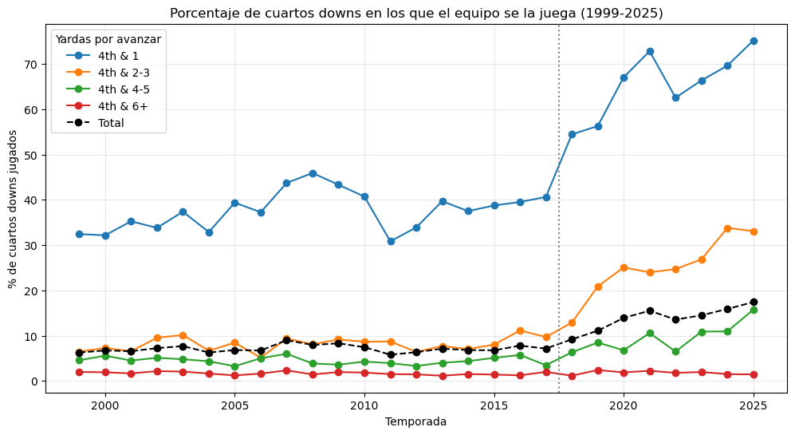
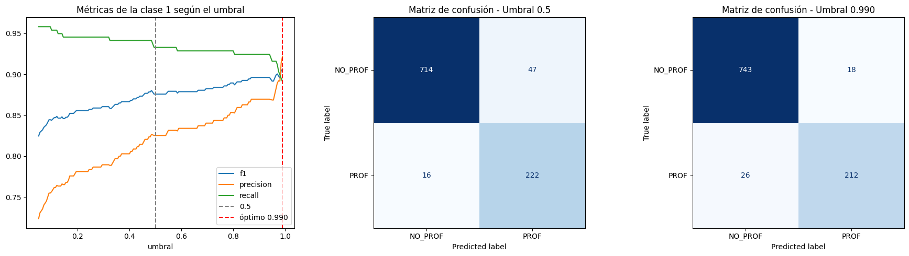
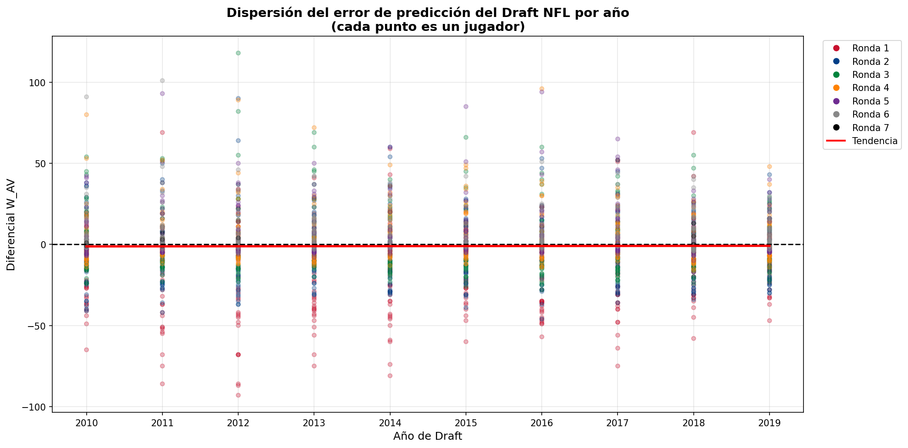
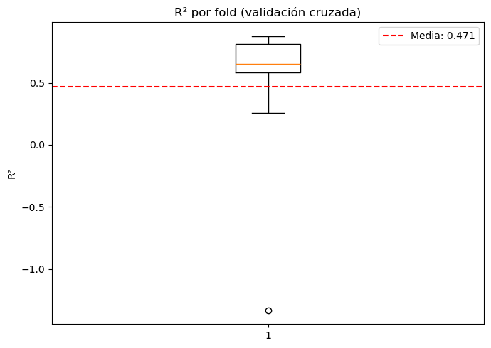
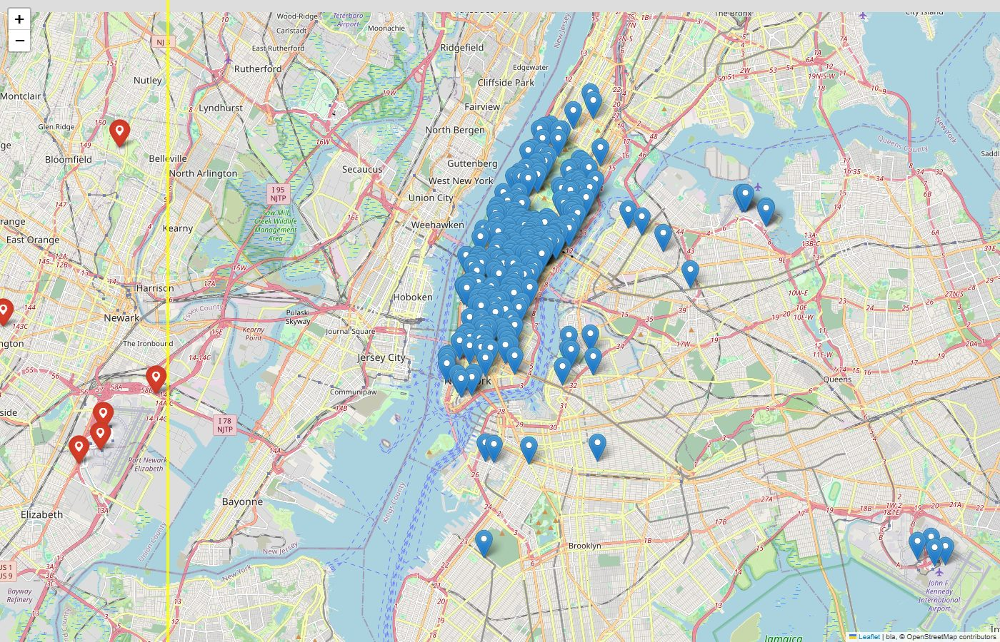
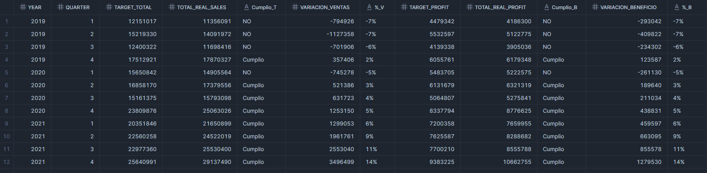
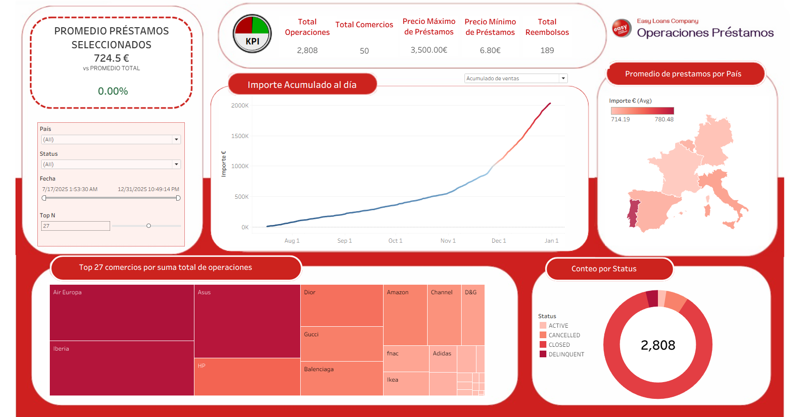
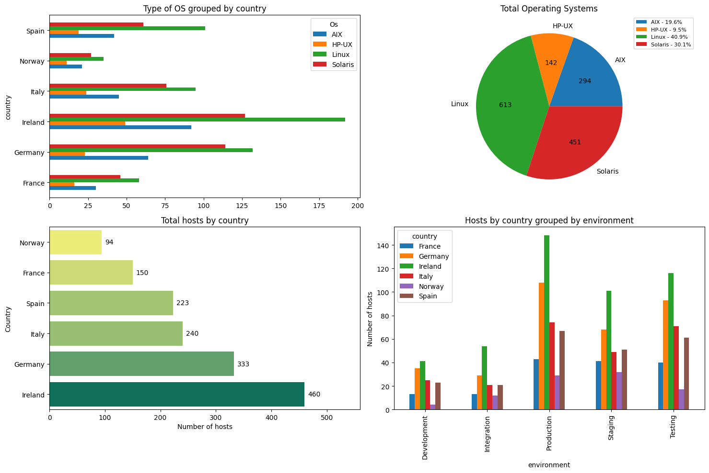

# MSc Data Science coursework

Eight assignments from the Master's in Data Science, Big Data & Business Analytics at Universidad Complutense de Madrid (2025–2026), covering data visualisation, machine learning on text, NoSQL and SQL databases, distributed processing with Spark, data mining, Python and business intelligence. All individual work. Each folder has its own README with the method, the results and the figures.

| | Assignment | Result |
|---|---|---|
|  | **[How data and rules changed the NFL, 1999–2025](visualisation)** · a visual report over 1.2 million plays · pandas, matplotlib, Plotly | Teams went for it on 4th & 1 one time in three in 1999 and three in four in 2025; kickers reach 8–9 yards further; offences convert 37.5 % of drives into points, up from 29.9 % |
|  | **[Professions in Spanish tweets](text-mining)** · fine-tuned transformers · Hugging Face, PyTorch | An out-of-fold ensemble of RoBERTuito and BETO detects tweets that mention a profession with **F1 0.925** and PR-AUC 0.961 |
|  | **[Does the NFL draft get it right?](nfl-draft)** · 3,312 drafted players in a document database · MongoDB, PyMongo | The spread of draft errors in rounds 1–3 did not shrink over 2010–2019; neither the Combine nor college stats explain more than 17 % of a career |
|  | **[Data mining](data-mining)** · regression, classification, clustering, time series · scikit-learn, statsmodels | Salary model with cross-validated **R² 0.756**; used-car price model with **31 % lower error** than the course's reference pipeline; ARIMA(0,1,2) for a stock series |
|  | **[Taxis and city events in New York](spark)** · 31 million trips · PySpark on Databricks | Trips joined in space (within 100 m) and time to the city's event feed: 3,269 evening trips arrive just before an event |
|  | **[SQL on Snowflake: Smart Desk](sql)** · business questions and a catalogue case study · Snowflake SQL | Targets met every quarter since Q2 2020; the country differences come from structurally different products, not from price |
|  | **[Easy Loans operations dashboard](tableau)** · Tableau | One interactive dashboard over 2,808 loan operations, with a hand-built gauge, LOD expressions and parameters |
|  | **[A synthetic server inventory](python-advanced)** · pandas, matplotlib | 1,500 hostnames generated from a naming convention and a target mix, decoded into a DataFrame and summarised in charts |

The Pump It Up machine-learning project has its own repository: [pump-it-up-water-table](https://github.com/mtorreslanda/pump-it-up-water-table) (peaked at #6 on DrivenData).

Notebooks are in Spanish and committed with their outputs, so they can be read directly on GitHub.

## Data

Raw data is not committed. The NFL notebooks download public [nflverse](https://github.com/nflverse) data; the draft notebook also uses the free [CollegeFootballData](https://collegefootballdata.com) API (set `CFBD_API_KEY` in your environment). The tweets are the public ProfNER subset on Hugging Face and the taxi trips the public NYC TLC records; the other datasets were provided by the course.

---
Miguel Ángel Castro Torreslanda · [mtorreslanda.com](https://mtorreslanda.com)
