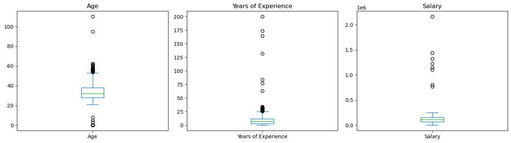
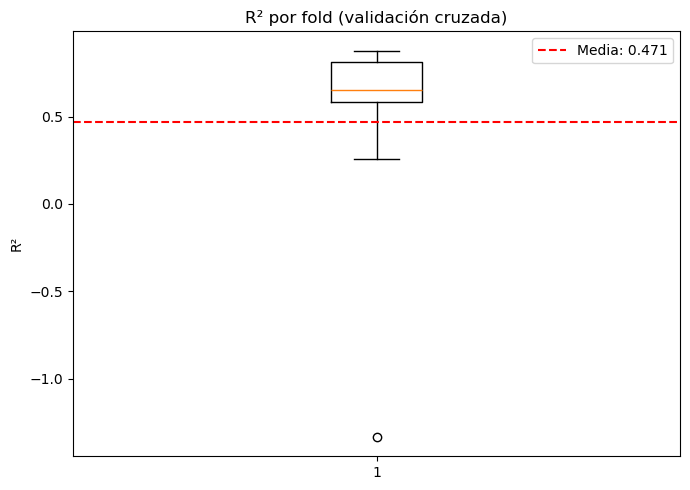
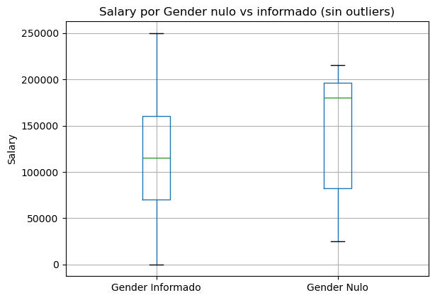
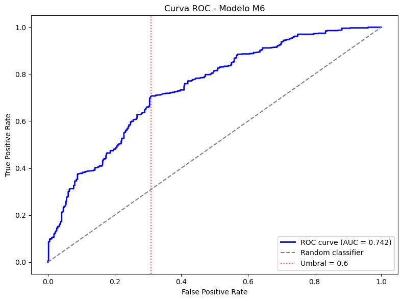
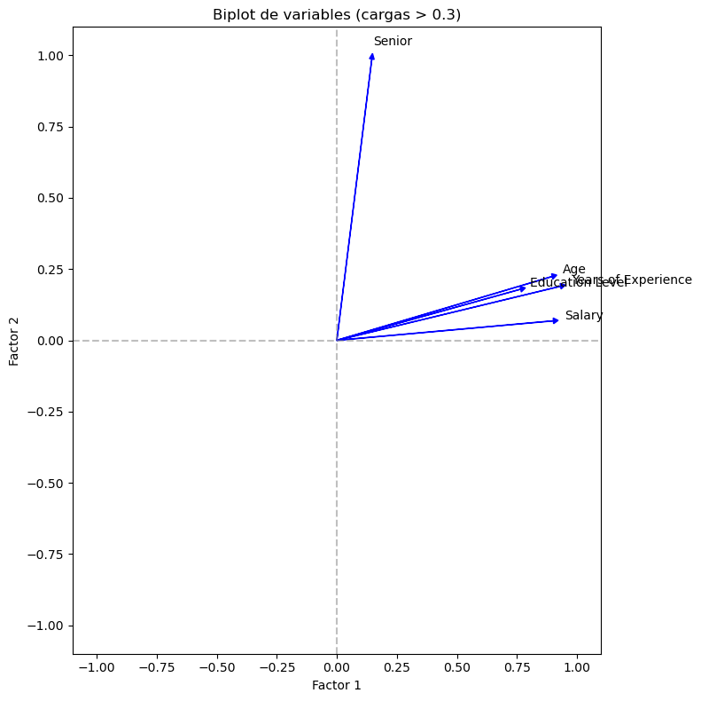
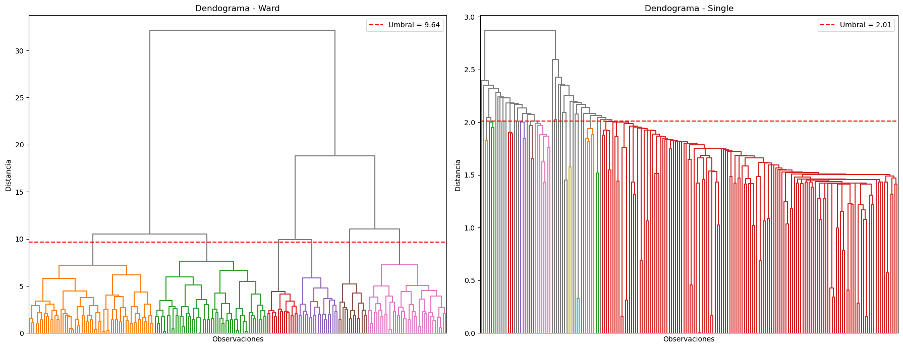
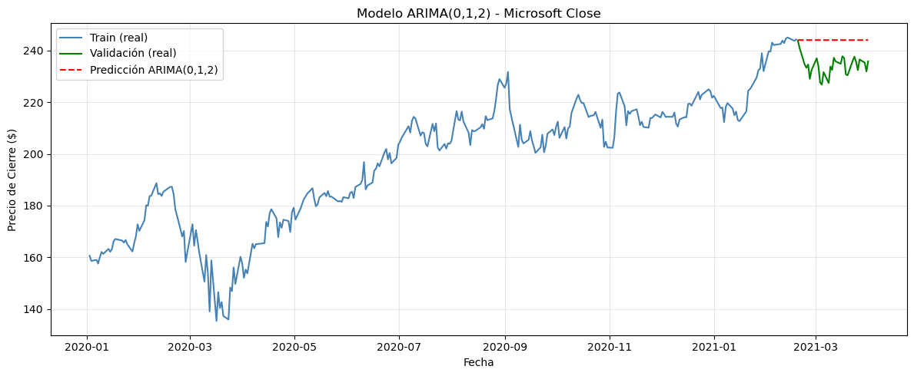
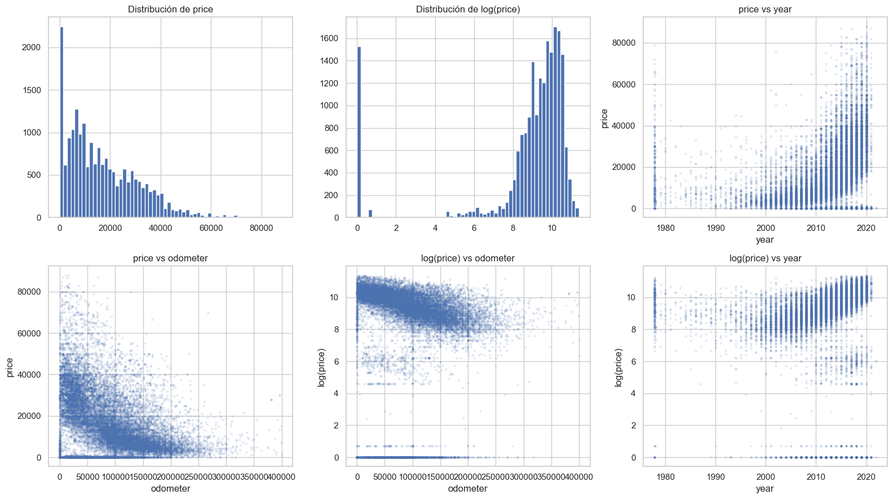
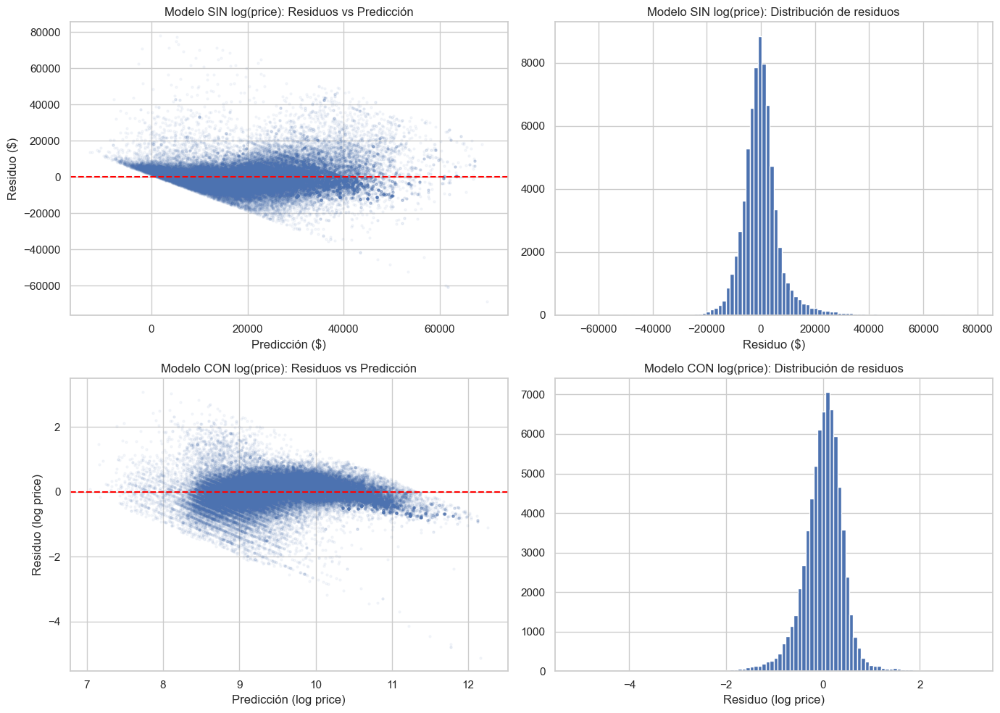

# Data mining: three end-to-end analyses

Three analyses from the Data Mining module of the MSc in Data Science, covering data understanding and preparation, linear and logistic regression, dimensionality reduction, factor analysis, hierarchical clustering and time-series forecasting, applied to a salary dataset, a stock price series and a used-car listings dataset.

| Analysis | Data | Result |
|---|---|---|
| Salary regression | 6,684 employees | Cross-validated **R² 0.756** with a well-conditioned, interpretable model (condition number 4.4) |
| Gender classification | same | **AUC 0.742**, recall balanced across classes (0.69 / 0.70) |
| Stock forecasting | Microsoft, Jan 2020 – Mar 2021 | **ARIMA(0,1,2)**, every coefficient significant, lowest AIC of the models tested |
| Used-car prices | 426,880 listings | **RMSE $7,153**, **31 % lower** than the best version of the course's reference pipeline |

The salary dataset before cleaning: employees aged 0 with up to 200 years of experience, and others aged 95 and 110.

## What I did

Each notebook follows the same discipline: understand the data before modelling it, justify every cleaning decision with evidence, and validate models out of sample.
- **Salary:** the dataset is used for four different tasks, so every transformation had to work for all four.
- **Stock:** the notebook goes from visual inspection to formal tests before fitting any model.
- **Used cars:** the notebook takes a provided preprocessing and modelling pipeline and improves it, measuring the gain against the original on the same terms.

## How it works

### Part 1 · Salary dataset

1. **Data understanding.** Distributions, correlations and Cramér's V between categorical variables.
   - The data contains impossible values: ages of 0 and 110, more years of experience than years alive, and salaries of 0 and of 2.16 million.
   - The job title variable has 129 categories, many with a single record.
2. **Missing values.** Each variable was checked to see whether its missing values are random.
   - They are not random for gender: employees with no gender recorded earn substantially more (median 180,000 vs 115,000; t-test p = 0.0003).
   - Gender was therefore imputed by sampling from the gender mix of each salary quartile, which runs from 54 % female in Q1 to 34 % in Q4. Using the global proportion would have biased the imputed records.
3. **Outliers.** Z-score and IQR were compared for each variable.
   - The eight extreme salaries all came from records with age 0 and experience 0, so they were removed as data-entry errors.
   - The remaining age-0 records showed no salary difference from the rest (t-test p = 0.11), so removing them introduced no bias. The impossible experience values disappeared with them.
   - In total 118 records (1.77 %) were removed, well under the 5 % budget.
4. **Linear regression for salary.** Five variants:
   - a full model;
   - forward selection by AIC;
   - a PCA model;
   - two ways of bringing job title back in: target encoding, and grouping into ten functional areas.

   Each was checked for residual normality, autocorrelation and multicollinearity.
5. **Logistic regression for gender.**
   - Factor analysis with Varimax rotation to remove collinearity.
   - Seven progressively richer models with LASSO regularisation.
   - A decision threshold chosen on the validation set.
6. **Hierarchical clustering.** Ward and single linkage were compared on standardised data. The number of clusters was chosen with the silhouette score and the dendrogram.

### Part 2 · Microsoft stock price

1. **Stationarity**, assessed three ways:
   - visually;
   - with ACF / PACF;
   - with the augmented Dickey–Fuller test: p = 0.58, not stationary; p < 0.001 after first differencing.
2. **Models.** Holt's exponential smoothing, an autoregressive model and ARIMA are fitted on all but the last 30 trading days and evaluated on them.
3. **Model orders** are chosen from the correlograms and refined by coefficient significance and AIC.

### Part 3 · Used-car prices

The notebook first reproduces the course's reference pipeline, then improves it in four steps:

1. **Cleaning the target.**
   - 30,367 listings have a price of 0. Their profile (mostly clean titles, normal mileage, newer than average cars) shows they are not real low-value sales but placeholder or erroneous prices, so they were removed.
   - The floor for the remaining low prices was set statistically: the IQR of log-price, computed after excluding the zeros, gives **$1,050**.
   - 358,813 listings remain.
2. **Using the car model, not just the make.** `model` has thousands of categories, too many for one-hot encoding, so it was encoded hierarchically:
   - the mean price of each manufacturer, shrunk towards the global mean;
   - the mean price of each model, shrunk towards its manufacturer;
   - all computed on training data only.
3. **Linearising relationships.**
   - Log-transformed mileage and log-transformed age describe price far better than the raw values.
   - A log-transformed target was also tested. It fits better in log space (R² 0.726), but its errors in dollars are worse (test R² 0.58 vs 0.73), so the final model predicts price directly.
4. **Validation.** Ten-fold cross-validation with shuffling. The encoding, transformations and scaling are refitted inside every fold, so no information leaks between folds.

## Findings

**A negative R² in one fold exposed hidden order in the data, not a weak model.**
- Unshuffled 10-fold cross-validation of the salary model gave a mean R² of 0.471, with one fold at −1.33.
- That fold's salaries had a median of 160,000, against 110,000 elsewhere, because the file is sorted.
- With shuffling, the same model scores 0.707 ± 0.017, matching its training R² of 0.706.

**The same problem appeared in the used-car data, and its cause was traced to geography.**
- In the reference pipeline's cross-validation, fold 8 scored R² 0.19, against about 0.41 for the others.
- The listings are ordered by state, so that fold held almost only Oregon, Pennsylvania, Oklahoma and Ohio (0 % California, Florida or Texas), with systematically lower prices.
- Shuffled folds removed the anomaly.

**Missing gender values carry information.** Records without gender earn about 65,000 more at the median, a statistically significant difference. Imputing by salary band keeps the final gender split at 55.2 / 44.8, almost exactly the original 55 / 45.

**The model with the best R² was not the best model.** Five of the regression variants compared:

| Model | R² (CV) | RMSE (CV) | Condition number |
|---|---|---|---|
| All five variables | 0.707 | 28,523 | 337 |
| Forward selection (experience, education) | 0.690 | 29,345 | 24 |
| PCA, 4 components | 0.660 | 30,719 | 2.4 |
| **Job area (10 groups), standardised** | **0.756** | **26,055** | **4.4** |
| Job title target-encoded | 0.781 | 24,672 | 1,260,000 |

Target encoding scores highest, but it was rejected for three reasons:
- the encoded variable is built from the salary it predicts;
- its condition number is critical;
- it would fail on job titles not seen in training.

Grouping job titles into functional areas gives most of the gain with stable, interpretable coefficients, so that is the model selected.

**Gender is only weakly predictable from career data, and the analysis says so.**
- The best logistic model reaches AUC 0.742 and 70 % accuracy, with a pseudo-R² of 0.153.
- Raising the threshold from 0.5 to 0.6 corrected a bias towards the majority class: female recall rose from 0.48 to 0.69, with male recall at 0.70.
- A capitalisation inconsistency was found along the way: "Front End Developer" and "Front end Developer" (30 and 238 records) were producing a spurious coefficient of 0.49. Once merged, it falls to −0.03.

**Two latent factors describe the employees.**
- One factor (eigenvalue 3.32, 66 % of the variance) combines age, experience, salary and education: career trajectory.
- After Varimax rotation, a second factor is almost entirely the seniority flag (loading 0.99). Formal seniority is a separate dimension from experience.

**Three professional profiles emerge from clustering.** Single linkage chains everything into one cluster. Ward produces balanced groups, and the silhouette score peaks at k = 3:

| Cluster | Size | Age | Salary | Experience | Profile |
|---|---|---|---|---|---|
| 1 | 2,923 | 28 | 68k | 3 years | Junior; includes most sales roles |
| 2 | 959 | 40 | 144k | 13 years | Senior with formal seniority, corporate roles |
| 3 | 2,802 | 37 | 155k | 12 years | Mid-senior technical: data, finance, research |

The best-paid group is the technical one *without* formal seniority.

**In the stock series, the simplest well-specified model wins.**
- The partial autocorrelation suggested AR(2), but the second lag was not significant (p = 0.44), so AR(1) was kept.
- Among the ARIMA candidates, (1,1,2) had a non-significant AR term (p = 0.92). Removing it gives ARIMA(0,1,2): all coefficients significant and the lowest AIC (1,645).
- Its negative first MA term (−0.31) describes a real property of the series: sharp moves tend to be partly corrected in the following days.

**Car prices are not linear in mileage or age, but their logarithms almost are.** Price falls steeply over the first miles and years and then levels off. The log transforms straighten both relationships.

**The used-car model cuts the error of the reference pipeline by 31 %.**
- On the same dollar scale, RMSE falls from $11,399 (reference model) and $10,416 (improved reference) to **$7,153**.
- The result is stable across folds: R² 0.738 ± 0.003, MAE $4,874.
- The main contributors are the hierarchical encoding of make and model, the evidence-based cleaning of the target, and the log-transformed predictors.

## Conclusions

- **Cleaning decisions should be tested, not assumed.** Whether missing values are random, whether outliers are errors and whether removed records differ from the rest were all checked statistically before acting on them.
- **Validation needs as much scrutiny as models.** In two different datasets, what looked like an unstable model was a fold-construction problem, diagnosed by inspecting the composition of the failing fold.
- **Interpretability and stability can be worth a few points of R².** The selected salary model gives up 0.025 of R² against target encoding to avoid leakage and multicollinearity.
- **Some limits are in the data, not the model.**
  - No model that only sees past prices can anticipate the shocks that move a stock.
  - Career variables only weakly predict gender.
  - The used-car model still shows heteroscedasticity at high prices, which points to non-linear models (random forests, gradient boosting) as the next step.

## Repository

| Notebook | Content |
|---|---|
| [`part1_salary_regression.ipynb`](part1_salary_regression.ipynb) | Data understanding and preparation, linear and logistic regression, PCA, factor analysis, clustering |
| [`part2_stock_time_series.ipynb`](part2_stock_time_series.ipynb) | Stationarity, exponential smoothing, AR and ARIMA |
| [`part3_used_car_prices.ipynb`](part3_used_car_prices.ipynb) | Reference pipeline, improved preprocessing and model, fold-8 investigation |

The notebooks are in Spanish and include their outputs. The datasets were provided by the course and are not included.

**Stack:** Python, pandas, scikit-learn, statsmodels, SciPy, seaborn.
