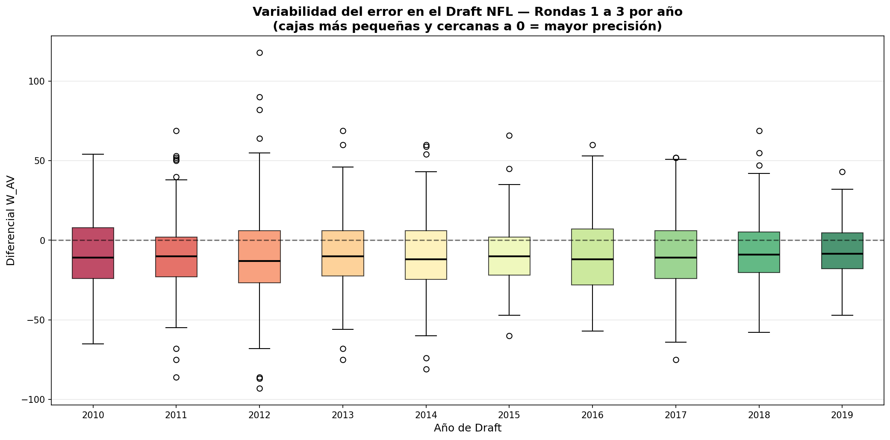
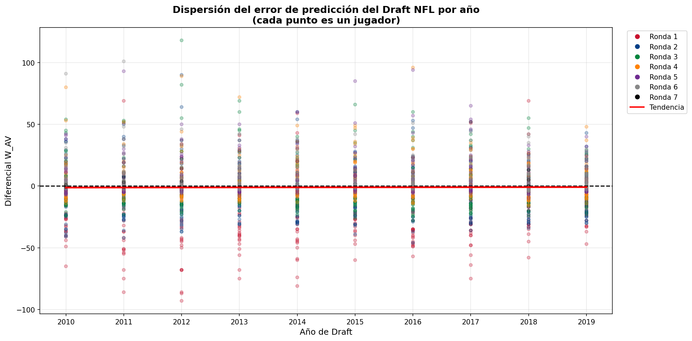
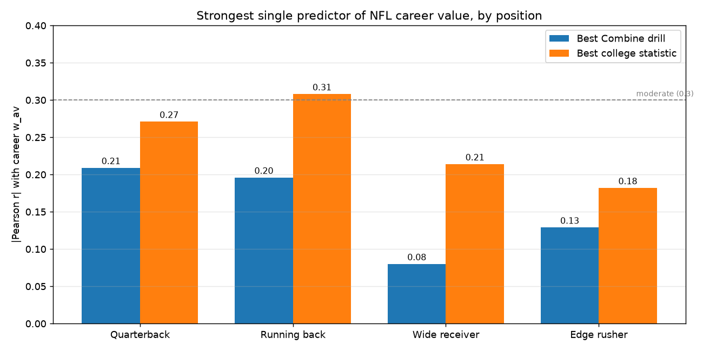
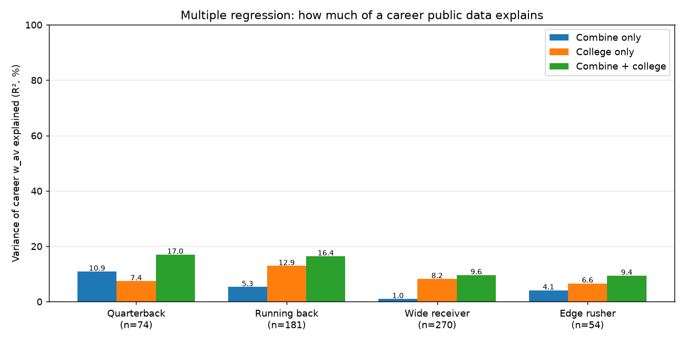

# Does the NFL draft get it right?

A MongoDB project from the MSc in Data Science. It integrates draft, NFL Combine and college statistics for 3,312 players drafted between 2010 and 2022 into a document database, then uses aggregation queries and Python to assess how accurately teams draft and whether public data can predict NFL success.

| Question | Result |
|---|---|
| Have teams become more accurate at drafting? | **No.** The spread of draft errors in rounds 1–3 is unchanged across 2010–2019 |
| Is there an exception? | **First-round quarterbacks**: average career value rose from 2015, peaking with the 2017–2018 classes |
| Does the Combine predict success? | **No.** No drill correlates above 0.21 with career value at any position |
| Do college statistics predict it? | **Weakly.** Best single predictor r = 0.31; combined models explain at most 17 % |


<sub>Average gap between each pick's career value and the value available at that slot with perfect hindsight, by round. Negative means the team could have taken a better player.</sub>

## What I did

I built a document database of every drafted player, measured success with Pro Football Reference's weighted Approximate Value (w_av), and created a metric of draft accuracy that compares each pick with the best player available at that slot. The analysis tests three hypotheses:
- the Combine has limited predictive power, and it varies by position;
- college statistics predict better than athletic testing;
- the draft contains systematic steals and busts that data can identify.

## How it works

1. **Data integration.** Three public sources were combined:
   - draft picks and Combine results from nflverse (3,320 picks, 36 variables);
   - more than 106,000 season-level college records from the CollegeFootballData API (passing, rushing, receiving, defence);
   - CFBD's draft endpoint, which supplied the college athlete ID used to link the two.

   Linking the sources took three iterations:
   - joining on round and pick matched only first-round players (171), because one source numbers picks within each round and the other across the whole draft;
   - switching the key to the overall pick number raised the match to 3,263;
   - the API returns negative athlete IDs for some players, and treating them as missing left 2,797 valid links (84 % of 3,312).

   Tom Brady (2000 draft, outside the range) was inserted by hand as a reference, because the API has no college data before 2004.
2. **Document model.** Each player is one JSON document with five sections: profile, draft, NFL career, Combine and an array of college seasons. A quarterback and an edge rusher have entirely different fields, and documents hold that shape without the sparse columns a relational schema would need.

   ```json
   {
     "nombre": "Patrick Mahomes",
     "posicion_grupo": "QB",
     "universidad": "Texas Tech",
     "draft":      { "temporada": 2017, "ronda": 1, "pick": 10, "equipo": "KAN" },
     "nfl_career": { "w_av": 115, "probowls": 6, "allpro": 2, "seasons_started": 8 },
     "combine":    { "cuarenta": 4.8, "bench": null, "vertical": 30, "broad_jump": 114, "cone": 6.88 },
     "college_stats": [
       { "temporada": 2016,
         "passing": { "ATT": 591, "PCT": 0.657, "YDS": 5052, "TD": 41, "INT": 10 },
         "rushing": { "CAR": 131, "YDS": 285, "TD": 12 } }
     ],
     "draft_value": { "clasificacion": "gran_robo", "pick_perfecto": 1, "diferencial_wav": 52.0 }
   }
   ```
   <sub>Excerpt of one document (field names in Spanish, as in the database; two of his three college seasons omitted). With perfect hindsight Mahomes would have been the first pick of 2017; he outperformed the player available at pick 10 by 52 points of w_av.</sub>
3. **Exploration with aggregation pipelines.**
   - Players by position and average w_av by round.
   - The distribution of w_av, and how it relates to Pro Bowls.
   - Combine participation by position, which differs sharply: only 1 of 149 quarterbacks did the bench press.

   ```js
   db.players.aggregate([
     { $match: { posicion_grupo: { $ne: null } } },
     { $group: { _id: "$draft.ronda",
                 total_jugadores: { $sum: 1 },
                 w_av_promedio:   { $avg: "$nfl_career.w_av" } } },
     { $sort: { _id: 1 } }
   ])
   ```
4. **A new field: `draft_value`.**
   - Each draft class is re-ordered by actual career value to obtain the pick every player *should* have been.
   - The difference between what a team got and what was available at that slot is written back to every document with `bulk_write`.
   - Picks are classified as steal (30+ points above the slot), good value (10–29), accurate (±10) or bust (more than 10 below).
   - The metric went through three versions before this one: comparing each player with the 75th percentile of those still available, then adjusted thresholds, and finally the differential against the hindsight-optimal draft, which is the easiest to interpret.
   - Invalid values were then cleaned in place with `updateMany` and `$unset`.
5. **Statistical analysis in Python.** Data is pulled from MongoDB by position with PyMongo for:
   - Pearson correlations between w_av and each Combine drill and college statistic;
   - multiple regression with Combine data only, college data only, and both combined.

All queries are in [`mongodb_queries.js`](mongodb_queries.js).

## Findings

**Career value is extremely concentrated.**
- Of 3,032 players with a w_av, half have less than 10.
- Only 156 exceed 60, and that threshold works as a marker of sustained excellence: 144 of them (92 %) made at least one Pro Bowl, averaging 4.1 selections.
- First-round picks average 39.4, second-round 26.0 and seventh-round 6.0. The steepest drop is between rounds 1 and 2.
- The averages hide wide variance. The most valuable player in the database, Russell Wilson (w_av 140), was the 75th pick, and several of the 15 most valuable quarterbacks were taken well after the first round.

**The average suggested teams were improving; the spread shows they are not.**
- The mean error of first-round picks narrowed from between −17 and −27 (2010–2016) to −12 (2018–2019).
- The spread of errors, year by year, stays the same across the decade, both for the first round and for rounds 1–3 combined. Teams keep passing on clearly better players at a similar rate.





<sub>Each dot is a player: how far his career value landed from the best player available at his slot.</sub>

**Later rounds return more value than expected.** From round 4 on, average differentials are almost always positive. Where the cost of a mistake is lower, teams appear to take calculated risks that pay off.

**Quarterbacks are the exception.** The average w_av of first-round quarterbacks rose steadily from 2015, reaching 71 and 70 for the 2017 and 2018 classes (Mahomes, Josh Allen, Lamar Jackson). The same trend does not appear for first-round picks as a whole, which have no direction over the decade (best 2011, 54.9; worst 2013, 33.7).

**The Combine has almost no predictive power.** The strongest correlation at any position is 0.21 (three-cone drill, quarterbacks). The drills expected to matter most are not the best predictors. For running backs, for example, the broad jump (0.20) correlates more than the 40-yard dash (−0.12).

**College production predicts better, but still weakly.**

| Position | Best college predictor | r |
|---|---|---|
| Running back | rushing touchdowns | 0.31 |
| Quarterback | **rushing yards** | 0.27 |
| Wide receiver | receiving yards / touchdowns | 0.21 |
| Edge rusher | total tackles | 0.18 |

For quarterbacks, rushing yards predict career value better than any passing statistic, consistent with the rise of mobile quarterbacks.



**Combining every source explains little of a career.** Combine and college data together explain at most 17 % of the variance in w_av (in-sample R²):

| Position | Combine | College | Both |
|---|---|---|---|
| Quarterback | 10.9 % | 7.4 % | 17.0 % |
| Running back | 5.3 % | 12.9 % | 16.4 % |
| Wide receiver | 1.0 % | 8.2 % | 9.6 % |
| Edge rusher | 4.1 % | 6.6 % | 9.4 % |



<sub>Charts of the correlation and regression results printed in the notebook.</sub>

## Conclusions

- **The draft remains highly uncertain.** Across ten draft classes, teams have not reduced the size of their errors in the rounds where picks are most valuable. The improvement is specific to first-round quarterbacks.
- **Public data does not predict NFL success.** Neither athletic testing nor college production, nor both together, explain more than 17 % of a player's career value. Tom Brady (pick 199, with the slowest 40-yard time among quarterbacks in his class) is the extreme case of a systematic pattern, not an anomaly.
- **The environment may matter as much as the player.** Average w_av by drafting franchise ranges from 23.7 (New Orleans) to 15.3 (Minnesota). This does not prove causation, since good teams may simply draft better, but it points to team environment as the next question to study.
- **A document database fits this data.** Position-specific fields, nested college seasons and new derived fields such as `draft_value` were added without schema migrations.

## Repository

| File | Content |
|---|---|
| [`report_es.pdf`](report_es.pdf) | Full report with every query and its interpretation (Spanish) |
| [`mongodb_queries.js`](mongodb_queries.js) | MongoDB queries and aggregation pipelines |
| [`nfl_draft.ipynb`](nfl_draft.ipynb) | Data download and integration, `draft_value`, correlations, regression and figures |

The CollegeFootballData API is free; set `CFBD_API_KEY` in your environment before running the notebook.

**Stack:** MongoDB, PyMongo, Python, pandas, scikit-learn, matplotlib, nfl_data_py.
