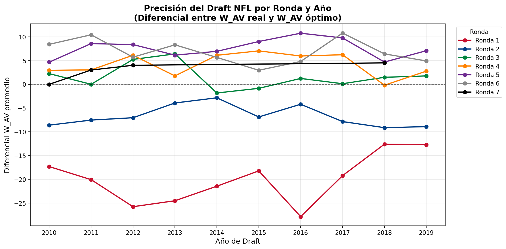

# Does the NFL draft get it right?

Can the combine and college production predict NFL success? Draft picks 2010–2022 (nflverse), combine
results and college stats (CollegeFootballData API) are merged, modelled as player documents and
queried in **MongoDB** ([`mongodb_queries.js`](mongodb_queries.js)). Report: [`report_es.pdf`](report_es.pdf) (Spanish).

The CollegeFootballData API is free; set `CFBD_API_KEY` in your environment before running.
