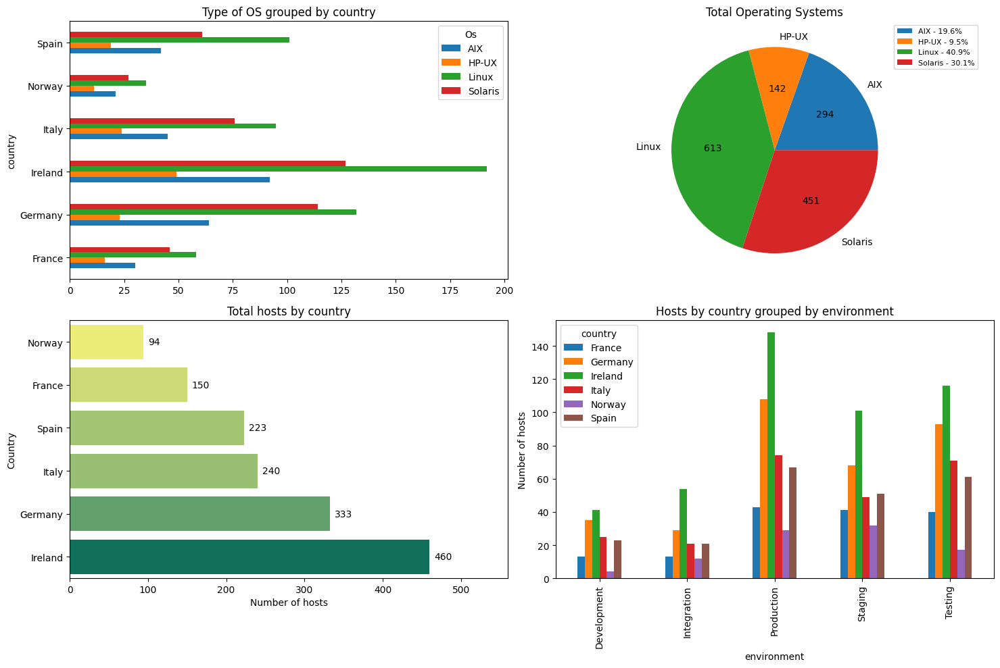
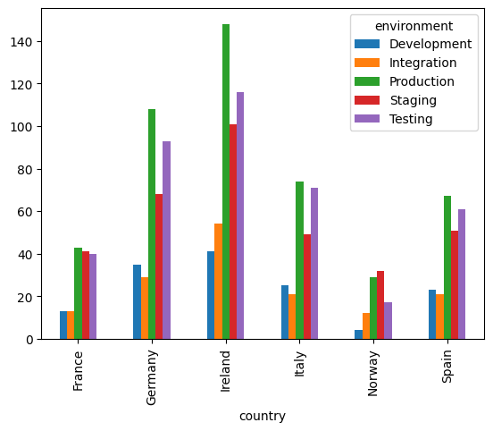

# Python: a synthetic server inventory

An assignment from the Advanced Python module of the MSc in Data Science. It generates the hostnames of 1,500 servers following a naming convention and a target mix of operating systems, environments and countries, decodes each name back into its attributes, builds a pandas DataFrame, saves it to CSV and summarises the inventory in a 2 × 2 figure.

| Attribute | Target mix | Generated (1,500 hosts) |
|---|---|---|
| Operating system | Linux 40 %, Solaris 30 %, AIX 20 %, HP-UX 10 % | Linux 40.9 %, Solaris 30.1 %, AIX 19.6 %, HP-UX 9.5 % |
| Country | Ireland 30 %, Germany 23 %, Italy 16 %, Spain 16 %, France 9 %, Norway 6 % | Ireland 460, Germany 333, Italy 240, Spain 223, France 150, Norway 94 |
| Environment | Production 30 %, Testing 25 %, Staging 25 %, Development 10 %, Integration 10 % | Production the largest group in every country except Norway |



<sub>The 2 × 2 figure produced by the notebook. The generated mix follows the target weights within about one percentage point.</sub>

## What I did

The brief defined the naming convention, the target proportions and the charts to reproduce. I implemented each step as a small function and chose lookup dictionaries and weighted sampling over chains of conditionals, so that changing the convention or the mix only means editing data, not code.

## How it works

1. **The naming convention.** Each hostname encodes four fields: one letter for the operating system, one for the environment, three for the country and a three-digit node number, for example `LPITA001` (Linux, Production, Italy, node 1).

   | Position | Field | Codes |
   |---|---|---|
   | 1 | Operating system | `L` Linux · `S` Solaris · `A` AIX · `H` HP-UX |
   | 2 | Environment | `D` Development · `I` Integration · `T` Testing · `S` Staging · `P` Production |
   | 3–5 | Country | `NOR` · `FRA` · `ITA` · `ESP` · `DEU` · `IRL` |
   | 6–8 | Node | `001`, `002`, … |
2. **Generating the names.** `random.choices` with weights draws the three codes for all hosts at once. The node number starts at 001 and increases until the name is unique, so two Linux production servers in Italy become `LPITA001` and `LPITA002`.

   ```python
   def set_hostnames(number_of_hosts):

       lista_sistema_operativo = random.choices(sistema_operativo, k = number_of_hosts, weights = porcentaje_sistema_operativo) # aquí decidí usar los parametros del metodo random.choices para hacer las listas.
       lista_entorno = random.choices(entorno, k = number_of_hosts, weights = porcentaje_entorno)
       lista_paises = random.choices(paises, k=number_of_hosts, weights=porcentaje_paises)

       for i in range(number_of_hosts):
           nodo=1
           hostname_verificar= lista_sistema_operativo[i] + lista_entorno[i] + lista_paises[i] + str(f'{nodo:03}')
           while hostname_verificar in hostnames:
               nodo+=1
               hostname_verificar = lista_sistema_operativo[i] + lista_entorno[i] + lista_paises[i] + str(f'{nodo:03}')
           hostnames.append(hostname_verificar)
   ```
3. **Decoding them.** Four functions read each field back from its position in the name (`get_os`, `get_environment`, `get_country`, `get_node`), using the same dictionaries and flagging any code that is not in the convention as unknown.
4. **The DataFrame and the CSV.** One row per host with the hostname and its four decoded attributes; it is written to `hosts.csv` and read back to check the round trip.
5. **The charts.** Environments by country as grouped bars, and the 2 × 2 figure: operating systems by country, a pie of operating-system totals labelled with counts and a legend with percentages, hosts per country with value labels, and hosts by environment and country.



## Repository

| File | Content |
|---|---|
| [`hostname_inventory.ipynb`](hostname_inventory.ipynb) | The full assignment, with outputs (Spanish comments) |

The names are drawn without a fixed seed, so every run produces a different inventory with the same proportions; the figures above are from the submitted run.

**Stack:** Python, pandas, matplotlib, seaborn.
