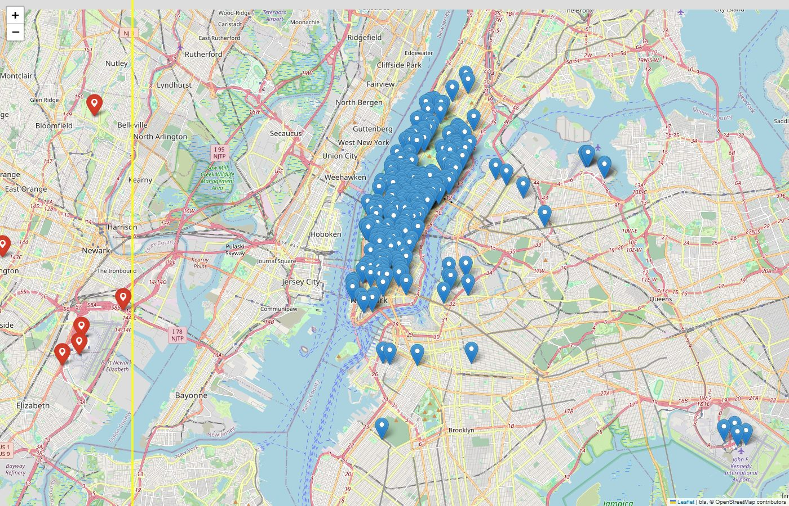

# Taxis and city events in New York (PySpark)

A PySpark project from the MSc in Data Science. It cleans three months of New York yellow-taxi trips (January–March 2016, about 31 million rows) and the city's 511 event feed, then joins them in space and time to find the trips that arrive at an event venue shortly before an evening event starts, and compares them with the rest of the trips to the same venues.

| Step | Result |
|---|---|
| Trips after cleaning | **31,088,883** |
| Pickups outside the city's bounding box | 440,553 (1.4 %) |
| Events in the 511 feed | 13,715, of which **12,282** remain after parsing dates and times and removing duplicates |
| Evening trips ending within 100 m of an event venue | **184,492** |
| …that arrive in the 20 minutes before an evening event | **3,269** (1.8 %) |

The map produced by the notebook: a 0.001 % sample of pickups inside the bounding box in blue (Manhattan, LaGuardia, JFK) and a 1 % sample of those outside it in red, around Newark and its airport. The yellow line is the box's western edge. Map tiles © OpenStreetMap contributors.

## What I did

The course set the question and the steps; the work is in implementing them in Spark at full scale and reading the results critically. Every DataFrame is built as a single chain of transformations, and each step is checked against the expected counts before moving on.

## How it works

1. **Cleaning the trips.** The three monthly CSV files are read with an inferred schema, cleaned by the same function and concatenated with `union`.
   - Trips with zero or negative distance or fare, or with a total below the metered fare, are removed.
   - So are trips shorter than 0.62 miles (1 km) or 2 minutes, which are most likely recording errors.
   - Each trip gets an identifier (a hash of its pickup and drop-off times), its duration in seconds, pickup and drop-off hour, day of the week, average speed and tip as a share of the total.
2. **Parsing the event feed.** The 511 file needed four repairs:
   - timestamps come in two formats (12-hour with seconds, and 24-hour without), so both are tried in turn with `coalesce`;
   - coordinates use a decimal comma in some rows and are converted to numbers;
   - events created well in advance carry their real date only in the free-text description ("Thursday April 5th, 2018 thru Saturday April 7th, 2018"), which a regular expression extracts, falling back to the closing time;
   - start and end times are also hidden in the description ("07:00 PM thru 10:00 PM", "until 11:00 P.M."). When only the end is given, the start is set two hours earlier; when neither is, the closing time is used as the end.
3. **Separating pickups outside the city.** Trips picked up outside a bounding box around New York are set aside as location outliers, and samples of both groups are drawn on a map with folium.
4. **A spatial and temporal join.**
   - A distance function computes the Manhattan distance in metres between two coordinates, as Spark column expressions.
   - Evening events (starting from 18:00) in the three months are matched with trips arriving from 17:00.
   - A **left semi join** on the distance keeps the trips that end within 100 m of any event venue, without adding columns.
   - A **left join** then checks both distance and time, keeping every trip and attaching the event when the trip arrives 0–20 minutes before it starts.
   - Some events appear twice at the same venue and time, once as "special event" and once with their specific type. A window count per trip removes the generic duplicate.
5. **Demand around events.** Trips are aggregated by arrival hour and event type (a pivot table) and by event type alone: number of trips, mean and median distance and duration, share paid by card and mean tip.

## Findings

**Taxis to events are a small share of the traffic around venues.** Of the 184,478 evening trips that end within 100 m of a venue (after removing duplicates), 3,269 arrive in the 20 minutes before an evening event. The other 181,209 coincide with a venue but not with an event.

**Special events, hockey games and concerts draw the most taxis, and arrivals peak at 19:00–20:00.** Concert-goers travel 2.08 miles on average, and 60 % of them pay by card. Many of the 11 event types have no trips at some hours, which is why the pivot table has so many empty cells.

**The means said the groups were very different; the medians said they were not.**
- Mean trip distance ranges from 1.41 to 47.83 miles across groups, but the medians are almost all between 1.3 and 1.6. Durations behave the same way.
- The extreme mean comes from a single trip: **8,330,083 miles in 9 minutes, for $9.80**, an obvious meter error. On its own it raises the mean of the no-event group by about 46 miles; without it the mean would be about 1.86.
- It survived the cleaning because the specification only filtered a minimum distance, not a maximum.

**A step in the specification drops the time of day.** To handle events that end after midnight, the specification adds one day to the end time with `F.date_add`. That function returns a date, not a timestamp, so those events end at 00:00. I followed the specification, since the grading depended on it, and noted in the notebook that `F.timestamp_add("DAY", 1, ...)` keeps the time.

## Conclusions

- **Free text needs as much engineering as the join.** Most of the event feed's useful information (real dates, start and end times) was in the description, and each fallback (closing time, a two-hour default) is an assumption that shapes the result.
- **Check the median before trusting a mean.** One impossible trip was enough to make a group's trips look 25 times longer than they were.
- **The join finds coincidences, not causes.** Knowing whether an event actually brings taxis would need a baseline: the same venues at the same hours on days without an event.

## Repository

| File | Content |
|---|---|
| [`nyc_taxi_spark.ipynb`](nyc_taxi_spark.ipynb) | Cleaning, event parsing, outlier map, spatial-temporal join and aggregations |
| [`aux_func.py`](aux_func.py) | Map helper provided by the course (folium) |

The notebook is in Spanish. It ran on Databricks with Spark 4.1, and its outputs are the course's check cells (all passing) and the map, which is stored as HTML (a capture is shown above). Data: public NYC TLC trip records and NY 511 events, not included.

**Stack:** PySpark 4.1 (DataFrame API, window functions, pivot), Databricks, folium.
