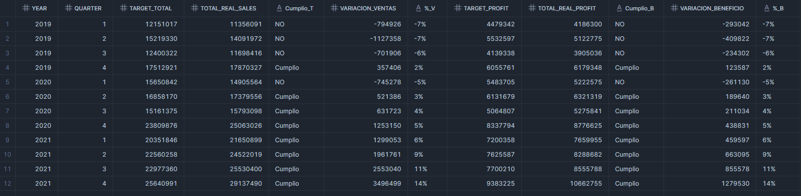
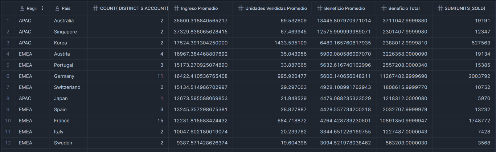

# SQL on Snowflake: Smart Desk

The final project of the SQL Databases module of the MSc in Data Science. A furniture and office-equipment company's data (sales, accounts, quarterly targets and sales forecasts) is queried in Snowflake to answer four business questions, followed by a case study that takes one anomaly from those answers and follows it to a question about how the product catalogue is managed.

| Question | Result |
|---|---|
| Profit by product category for one key account (2020) | Electronics **36 %** margin vs chairs **33 %**, driven by technical support; the effect does not hold across all accounts |
| Performance by country in APAC and EMEA | Australia and Singapore earn **$13.4k and $12.6k** of profit per transaction, more than double Germany and France, which earn almost **60 %** of the two regions' profit |
| Industries with near-closing deals over $500k | **7** industries qualify, 4 of them above $1M of profit; **4** committed accounts have no sales yet |
| Quarterly sales and profit vs target (2019–2021) | Every target met since **Q2 2020**, with the overshoot growing from 3 % to **14 %** |
| Case study: what explains the country differences? | Not price; the markets sell structurally different products, margin is **33–36 %** in every region, and the highest total profit comes from a mid-priced mix |



<sub>Result of the targets query in Snowflake: real sales and profit against target for each quarter, whether the target was met, and the deviation in dollars and percent.</sub>

## What I did

The four questions came from the course. For each one I wrote the query, then extended it where the requested output left something unexplained: account counts and totals next to averages, met/not-met flags, the percentage deviation from target. The case study is my own question, developed from an anomaly in the country comparison. The written report explains every query and its interpretation.

## The data

Four tables in a Snowflake schema:

| Table | Content | Joined on |
|---|---|---|
| `sales` | One row per sale: account, date, year and quarter, product category, units sold, revenue by line (product, parts, maintenance, support), total and profit | — |
| `accounts` | One row per client: industry, region and country | `sales.account = accounts.account` |
| `forecasts` | Open opportunities: account, category, stage (`Commit` or `Pipeline`), forecast amount and opportunity age in days | `forecasts.account = accounts.account` |
| `targets` | Sales and profit targets per quarter | `sales.year = targets.year` and `sales.quarter = targets.quarter_of_year` |

Before answering, I checked which countries exist in each region and used full outer joins to see which accounts appear in one table but not in another, so that no data was left out by an inner join without noticing.

## How it works

1. **Sales by product category** for Adabs Entertainment in 2020, broken down by revenue line, units and profit; then the same aggregation over all accounts, to test whether the pattern generalises.
2. **Country comparison** in APAC and EMEA: average revenue, units and profit per transaction, plus the number of accounts and total profit per country; then by country and category, to look for the source of the differences.
3. **Weighted pipeline by industry.** Accounts with forecasts in the `Commit` stage worth more than $500,000 in total are found with `GROUP BY ... HAVING` and used as a subquery filter. Their profit is aggregated by industry and classified with `CASE` as High (over $1M) or Normal. A window function puts the average opportunity age next to every deal:

   ```sql
   SELECT *, AVG(opportunity_age) OVER () AS promedio_OA
   FROM   forecasts
   WHERE  account IN (SELECT account
                      FROM   forecasts
                      WHERE  prediction_category = 'Commit'
                      GROUP  BY account
                      HAVING SUM(forecast) > 500000)
   ORDER  BY account;
   ```

   Since the brief could be read as classifying either historical profit or the forecast, a second version with two CTEs classifies by forecast.
4. **Actual vs target by quarter.** Sales are joined to targets on year and quarter. Beyond the requested deviation, I added a met/not-met flag and the deviation as a percentage, so the trend can be read at a glance:

   ```sql
   SELECT s.year, s.quarter, target_total,
          TRUNCATE(SUM(total), 0) AS Total_Real_Sales,
          CASE WHEN Total_Real_Sales > target_total THEN 'Cumplio' ELSE 'NO' END AS "Cumplio_T",
          (Total_Real_Sales - target_total)                     AS Variacion_Ventas,
          ROUND((Variacion_Ventas * 100) / target_total) || '%' AS "%_V",
          ...
   FROM   sales s
   JOIN   targets t ON s.year = t.year AND s.quarter = t.quarter_of_year
   GROUP  BY s.year, s.quarter, target_total, target_profit
   ORDER  BY year, quarter;
   ```

All queries are in [`smart_desk.sql`](smart_desk.sql).

## Findings

**Technical support made one account's electronics more profitable, but not the company's.**

| Adabs Entertainment, 2020 | Maintenance | Product | Parts | Support | Total | Units | Profit | Margin |
|---|---|---|---|---|---|---|---|---|
| Electronics | $250,000 | $1,250,000 | $100,000 | **$500,000** | $2,100,000 | 3,571 | $756,000 | **36 %** |
| Chairs | $400,000 | $1,235,672 | $200,000 | $0 | $1,835,672 | 3,529 | $605,772 | **33 %** |

- The difference comes from support: $500k, 24 % of electronics revenue, while chairs have none. Every extra million of electronics revenue at this account brings about $30k more profit than in another category.
- Across all accounts the pattern disappears: every category earns between 34.5 % and 35.9 %, with chairs the highest. The question becomes what that account's team does differently.

**The most profitable markets per sale are the smallest.**



<sub>Result of the country query: accounts, average revenue, units and profit per transaction, total profit and units sold.</sub>

- Australia and Singapore, with two accounts each, earn $13.4k and $12.6k of profit per transaction, but $3.7M and $2.3M in total.
- Germany (11 accounts) and France (15) earn $5.6k and $4.3k per transaction, but $11.3M and $10.9M in total: together, almost 60 % of the profit of both regions. That concentration in high-volume, low-profit-per-sale markets is a risk: it depends on moving large volumes and is exposed to price competition.
- Two gaps stand out. Japan, the world's third-largest economy, has a single account and below-average results; India has none, although APAC has the highest average profitability.

**Four committed deals have been stuck for over a year.**

| Industry | Profit of qualifying accounts | Category |
|---|---|---|
| Consulting | $1,846,700 | High |
| Retail | $1,381,958 | High |
| Technology | $1,309,161 | High |
| Healthcare | $1,168,570 | High |
| Hospitality | $889,699 | Normal |
| Law | $858,244 | Normal |
| Finance | $432,000 | Normal |

- Twelve accounts have committed forecasts above $500k; eight of them have bought before, and their industries are classified above. Hospitality and Law are close enough to $1M that a small push would move them up.
- The other four have never bought anything, and each has a committed forecast of $1,248,635:

  | Account | Category | Forecast | Opportunity age |
  |---|---|---|---|
  | FanTickets | Electronics | $1,248,635 | 383 days |
  | Lowe Recreation | Desks | $1,248,635 | 383 days |
  | Padberg Health Recruiting | Desks | $1,248,635 | 383 days |
  | Shoppers FastMart | Desks | $1,248,635 | 383 days |

  At 383 days, more than double the portfolio average of 148, they have been negotiating for over a year. With the prospecting already done, they are the opportunity with the most immediate return, and the work is to find what is blocking the close.
- Nine industries (Manufacturing, Insurance, Banking, Entertainment and Media, Real Estate, Automotive, Home Services, Education, Biotech and Pharmaceutical) have no qualifying deals at all, which concentrates future revenue in few sectors.

**The company missed its targets until Q1 2020 and has beaten them by more every quarter since.** It fell 5–7 % short in four of the first five quarters. From Q2 2020 the overshoot rose every quarter, from 3 % to 14 % in Q4 2021, for both sales and profit (table at the top).

## Case study: managing the product catalogue

**The anomaly.** The country comparison left something unexplained: the countries with the highest profit per transaction are not the ones with the highest total profit. Germany and France earn little per sale but lead in total; Australia and Singapore earn the most per sale but much less in total.

**The business question.** Is there an optimal product mix in Smart Desk's catalogue that maximises total profit, and is the company managing that mix deliberately, or is it the result of each market's organic demand?

**Hypothesis 1: price.** Perhaps APAC simply charges more for the same products. The implied unit price (product revenue divided by units, excluding a few negative-unit returns) tests it:

```sql
SELECT a.country,
       SUM(s.units_sold)                        AS unidades,
       ROUND(SUM(s.total))                      AS ingresos,
       ROUND(SUM(s.product) / SUM(s.units_sold)) AS precio_unitario,
       ROUND(SUM(s.profit))                     AS beneficio_total,
       COUNT(*)                                 AS transacciones
FROM   sales s
JOIN   accounts a ON s.account = a.account
WHERE  a.region IN ('APAC', 'EMEA') AND s.units_sold > 0
GROUP  BY a.country;
```

| Country | Units | Unit price | Total profit | Transactions |
|---|---|---|---|---|
| Germany | 2,003,792 | **$12** | $11,267,483 | 2,012 |
| France | 1,995,492 | **$11** | $10,704,301 | 2,462 |
| Australia | 19,191 | $350 | $3,711,043 | 276 |
| Austria | 19,134 | $350 | $3,226,358 | 546 |
| Portugal | 15,385 | $350 | $2,557,208 | 454 |
| Korea | 527,563 | **$8** | $2,388,013 | 368 |
| Singapore | 12,347 | $350 | $2,301,408 | 183 |
| Spain | 13,232 | $350 | $2,032,708 | 459 |
| Switzerland | 10,752 | $350 | $1,808,616 | 367 |
| Italy | 7,428 | $350 | $1,227,487 | 367 |
| Japan | 5,970 | $350 | $1,218,312 | 272 |
| Sweden | 3,568 | $350 | $563,203 | 182 |

The hypothesis is ruled out: Australia and Singapore sell at the same $350 as most countries. But the table shows something more important. Germany, France and Korea sell at $8–12 per unit, in volumes up to a hundred times larger, and the markets with the lowest unit price have the highest total profit. Prices this far apart are hard to explain as pricing of one product; they point to structurally different products, sometimes under the same category.

**How many products?** Breaking the unit price down by country, category and year shows three price groups, regardless of the category they are recorded under:

| Group | Unit price | Where | Example |
|---|---|---|---|
| Standard | about $350 | every market and category | the only product with a consistent global presence |
| Mid-value | about $180 | United States, Break room, 2021 only | 118,900 units and **$10.3M** of profit in one year: the best total profit of the three groups |
| Low-value | $2–18 | Germany, France, Korea, United States | Germany, Break room, 2021: 1,957,899 units at $4, $3.4M of profit |

**Which basket works best?** Grouping by country, with the average unit price of what each country buys classified as high (over $300), medium (over $70) or low:

| Country | Basket | Unit price | Profit per transaction | Total profit |
|---|---|---|---|---|
| Australia | high | $350 | $13,446 | $3.7M |
| Singapore | high | $350 | $12,576 | $2.3M |
| Korea | low | $8 | $6,489 | $2.4M |
| United States | **medium** | $82 | $5,835 | **$34.6M** |
| Germany | low | $12 | $5,600 | $11.3M |
| France | low | $13 | $4,264 | $10.9M |

<sub>Six of the 15 countries; the full table is in the report.</sub>

The most expensive basket is not the best, and neither is the cheapest: the highest total profit is in the country with a mid-priced basket.

**Is the margin stable?** A strategy built on more volume only works if margins hold:

| Region | Revenue | Profit | Margin | Profit per unit |
|---|---|---|---|---|
| North America | $97,961,834 | $34,639,851 | 35 % | $40 |
| EMEA | $96,959,247 | $33,387,364 | 34 % | $8 |
| APAC | $26,525,642 | $9,618,776 | 36 % | $17 |
| LATAM | $7,046,602 | $2,323,962 | 33 % | $198 |

The margin stays between 33 % and 36 % in every region: each extra dollar of revenue brings about $0.35 of profit, whatever the product. No product group is better than another in percentage terms; total profit depends on revenue volume and price, with the optimum somewhere in the middle.

**Recommendations.**
1. **Identify the mid-value product group and test it elsewhere.** The $150–180 group has the best total profit despite appearing in one country and one year. Finding exactly which product it is needs SKU-level data. Since margins are stable, any extra volume should translate directly into profit. In parallel, pilot low-value products in Australia and Singapore, which today sell only the $350 group.
2. **Commission a formal catalogue optimisation by market.** The data shows three product groups and their relative performance, but calculating the optimal mix needs SKU-level sales, a demand model per product and market, and scenario simulation.

## Conclusions

- **Averages and totals tell different stories.** Profit per transaction and total profit rank the countries very differently; reporting both is what exposed the case study's question.
- **A pattern in one account needs checking across all of them.** The support effect was real for Adabs Entertainment and absent in the aggregate.
- **The best result sits in the middle.** Neither expensive products at low volume nor cheap products at massive volume: the largest total profit comes from a mid-priced mix.
- **The catalogue looks unmanaged, which is the opportunity.** The mid-value group appears in one country and one year, the low-value group in four markets, and nothing in how products are spread suggests a deliberate strategy. The unit prices are inferred from revenue and units, and a sale can bundle several products, so the product groups are a statistical approximation that SKU-level data should confirm.

## Repository

| File | Content |
|---|---|
| [`smart_desk.sql`](smart_desk.sql) | Every query, with comments on the results |
| [`report_es.pdf`](report_es.pdf) | 20-page report: each question, its query, the result table and the analysis (Spanish) |

The dataset belongs to the course and is not included.

**Stack:** Snowflake SQL (joins, subqueries, CTEs, window functions, `CASE`).
