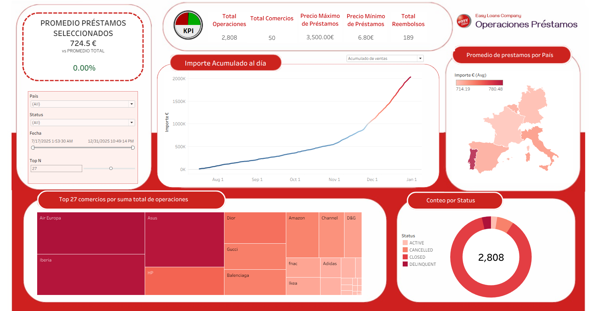

# Tableau: Easy Loans operations dashboard

The final project of the Business Intelligence with Tableau module of the MSc in Data Science. A single interactive dashboard for Easy Loans, a fictional lending company whose loans are made through partner merchants, built on its 2025 loan operations, merchants and refunds, and published to the course's Tableau Cloud site.

| KPI (all operations, 17 Jul – 31 Dec 2025) | Value |
|---|---|
| Loan operations | **2,808** |
| Merchants | **50** |
| Refunds | **189** |
| Largest / smallest loan | €3,500 / €6.80 |
| Average loan | **€724.5** |
| Average loan by country | between €714 and €780 |



<sub>The dashboard with no filters applied, so the selected average equals the overall average (0.00 %).</sub>

## What I did

I designed the dashboard as a single screen that answers the questions an operations manager would ask first: how much is being lent and to how many merchants, how the volume builds up over time, where the loans go, which merchants concentrate the business and in what state the loans are. Everything on it reacts to the same filters, and two parameters let the user change what is shown without leaving the screen.

## How it works

1. **Data model.** Three sheets of the course's Excel file, `Orders`, `merchant` and `refunds`, combined with Tableau relationships: orders to merchants on `merchant_id`, and orders to refunds on `order_id`.
2. **KPIs.** Calculated fields for the count of operations (`COUNTD([order_id])`), merchants, refunds, and the largest, smallest and average loan.
3. **Selected vs overall average.** The top-left card compares the average loan of whatever is selected with the average of all operations, fixed with a level-of-detail expression so it does not move with the filters:

   ```
   Precio medio fixed      = { FIXED : AVG([amount (Orders)]) }
   Desviación del Promedio = ([Promedio Préstamos] - AVG([Precio medio fixed])) / AVG([Precio medio fixed])
   Leyenda Promedio        = IF [Desviación del Promedio] < 0 THEN '▼' ELSEIF [Desviación del Promedio] > 0 THEN '▲' END
   ```
4. **A gauge built by hand.** Tableau has no gauge chart, so the KPI dial is built from a pie whose slices are calculated fields. The needle angle is the deviation from the overall average, clipped to a range set by a parameter (±70 % by default) and scaled to 90 degrees:

   ```
   Pos Aguja = 90 * ( MIN(MAX([Desviación del Promedio], -[Rango Gauge]), [Rango Gauge]) / [Rango Gauge] )
   ```

   Six more fields draw the dial: green slices before and after the needle when the selection is above average (`G1`, `G2`), red ones when it is below (`R1`, `R2`), a 3-degree needle in either case (`NG`, `NR`), and a hidden 180-degree slice that turns the pie into a half-circle (`Base Inferior`).
5. **A switchable time series.** A parameter, `Vista`, toggles the main chart between the cumulative amount lent per day (`RUNNING_SUM(SUM([amount (Orders)]))`) and the refunds by month, each shown only when selected.
6. **Where and with whom.**
   - A filled map of the average loan by country.
   - A treemap of the top N merchants by total amount, with N set by a parameter (27 in the capture).
   - A donut of operations by status (active, cancelled, closed, delinquent) with the total in the centre.
7. **Filters** for country, status and date range, plus the Top N control, applied to the whole dashboard. The brand banner and background are a custom image.

## What the dashboard shows

- **€2 million lent in five and a half months**, and the cumulative curve steepens from November: the second half of the period moves much more money than the first.
- **The average loan barely changes by country** (€714–780): the ticket size is similar in every market.
- **Two airlines lead the merchants.** Air Europa and Iberia have the largest totals in the treemap, followed by Asus, HP and Dior.
- **Refunds are a small share of operations**: 189 against 2,808 (under 7 %).

## Notes

The workbook and the data are not included: the dataset belongs to the course. The formulas above are the workbook's calculated fields, with Tableau's internal field IDs replaced by the field names.

**Stack:** Tableau (relationships, LOD expressions, table calculations, parameters), Tableau Cloud.
