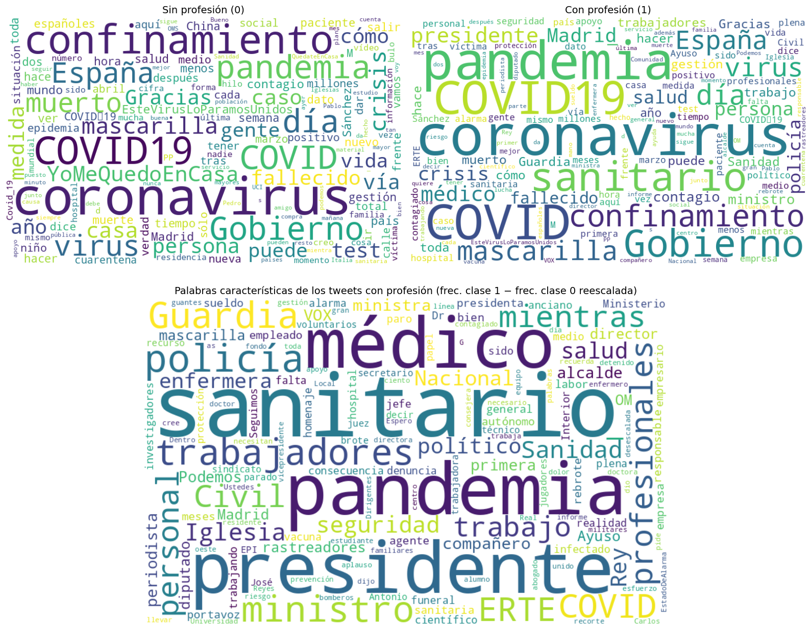
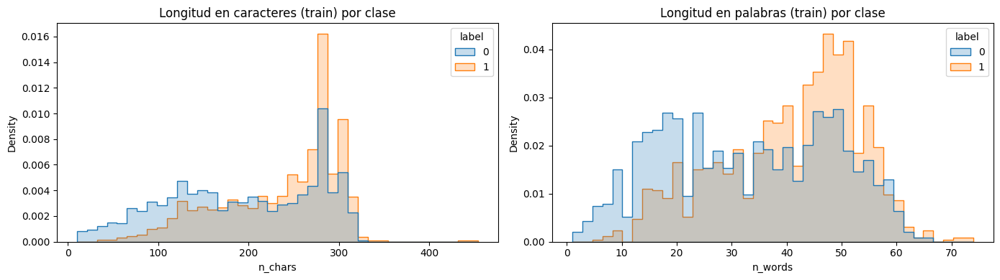
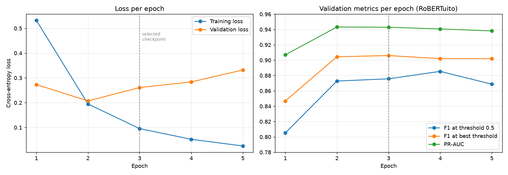
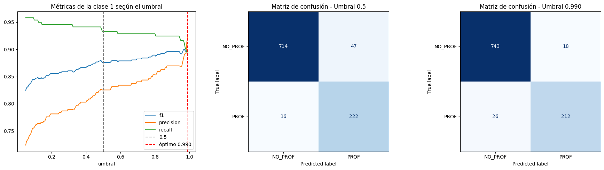

# Text mining: professions in Spanish tweets

A text classification project from the Text Mining module of the MSc in Data Science. It fine-tunes Spanish transformer models to detect whether a tweet mentions a profession, using the subset of the ProfNER shared task published on [Hugging Face](https://huggingface.co/datasets/luisgasco/profner_classification_master): Spanish tweets from the first months of COVID-19.

| | Result |
|---|---|
| Final model | Ensemble of RoBERTuito and BETO (8 fine-tuned models) |
| F1, profession class | **0.925** (precision 0.947, recall 0.903), out of fold |
| PR-AUC | **0.961** |
| Best single model | RoBERTuito, F1 0.906 with a tuned threshold |
| Multilingual baseline (TwHIN-BERT) | F1 0.829 |

The words of each class (top), and the words characteristic of tweets that mention a profession once the shared COVID vocabulary is discounted (bottom): health workers, police, ministers.

## What I did

The task is binary: label each tweet 1 if it mentions a profession and 0 otherwise, and submit predictions for an unlabelled test set, graded by F1. The work covers exploratory analysis, model selection, preprocessing matched to each model's pre-training, fine-tuning with a selection criterion suited to the class imbalance, threshold tuning, and an ensemble evaluated on predictions from models that never saw the tweets they score.

## How it works

1. **Exploratory analysis.**
   - 2,786 training tweets, 999 for validation and 1,001 for test, with no duplicates.
   - Tweet length and word clouds by class, including a contrastive cloud of the words over-represented in the profession class.
2. **Model selection.** Three pre-trained models were compared with the same pipeline, seed and hyper-parameters: a multilingual model trained on tweets (TwHIN-BERT), a Spanish model trained on 500 million tweets (RoBERTuito) and a general Spanish model (BETO).
3. **Preprocessing.**
   - No aggressive cleaning: stopwords, emojis and punctuation carry context for a model pre-trained on real tweets.
   - The corpus's pre-tokenised format is repaired: `# palabra` becomes `#palabra`, and split usernames and flags are rejoined.
   - RoBERTuito's official preprocessing is applied: mentions become `@usuario`, URLs become `url`, hashtags are split into words and emojis converted to text.
   - Chains of dozens of mentions are collapsed into one.

   Mean length falls from 55 to 46.5 tokens, and tweets longer than 64 tokens fall from 34.4 % to 16.8 %. A maximum length of 128 tokens covers 99.7 % of tweets, with dynamic padding per batch.
4. **Fine-tuning.**
   - Five epochs, learning rate 2e-5, warm-up over the first 10 % of steps, weight decay 0.01.
   - The best epoch is kept. It is selected by the best F1 achievable at any threshold rather than at 0.5, because F1 at 0.5 penalises epochs that separate the classes well but over-predict positives.
   - Fixed seeds throughout, so results are reproducible.
5. **Ensemble.** RoBERTuito and BETO are combined:
   - the validation set is split into two stratified halves; each model trains on train plus one half and predicts the other;
   - two seeds per model and half, so 8 models in total, each trained for a fixed 3 epochs;
   - the ensemble averages their probabilities, and the option and threshold are chosen on the out-of-fold predictions.

## Findings

**The validation set does not look like the training set, and the whole approach follows from that.**
- Training is balanced (1,393 / 1,393), while validation has only 23.8 % positives, so always predicting "no" would already score 76 % accuracy.
- F1 of the profession class is therefore the metric, and the decision threshold has to be tuned.
- Tweets that mention a profession are longer (median 259 characters against 198): naming a profession tends to come with more context.

**The discriminative vocabulary is professions in the news.** The word clouds of the two classes look alike because the shared COVID vocabulary dominates both. Discounting it reveals four groups:
- health workers (*sanitario, médico, enfermera*);
- security forces (*policía, Guardia Civil*);
- political offices (*presidente, ministro, alcalde*), which ProfNER counts as professions;
- collective terms (*trabajadores, personal*), which anticipate the borderline cases.

**Language matters more than domain.** With an identical pipeline:

| Model | Pre-trained on | F1 (threshold 0.5) | F1 (tuned threshold) |
|---|---|---|---|
| TwHIN-BERT | tweets, 100+ languages | 0.751 | 0.829 |
| **RoBERTuito** | **500 M Spanish tweets** | **0.876** | **0.906** |
| BETO | general Spanish | — | 0.920 (out of fold) |

A multilingual model spreads its capacity over a hundred languages; the two Spanish models are about 9 points ahead.

**The model overfits after two to three epochs, and the selection criterion catches it.** From epoch 3 the validation loss rises while the training loss keeps falling. The checkpoint with the best threshold-independent F1 (epoch 3) is the one kept.

Chart of the per-epoch training log printed in the notebook.

**Tuning the threshold mostly removes false positives.** Trained on 50 % positives, the model over-predicts the class. Raising the threshold from 0.5 to 0.99 reduces false positives from 47 to 18, at the cost of 10 more misses, and lifts F1 from 0.876 to 0.906.

**Preprocessing has to match pre-training.** The tweet-specific preprocessing that helps RoBERTuito hurts BETO (F1 0.920 → 0.901), because BETO was pre-trained on formal text. Each model therefore receives the preprocessing closest to its own pre-training corpus.

**Two complementary models beat either alone, measured without optimism.**
- Choosing the epoch and threshold on the same data used for reporting inflates the score. The ensemble is therefore evaluated only on out-of-fold predictions.
- It is best on every metric: F1 0.925 against 0.920 (BETO) and 0.919 (RoBERTuito), and PR-AUC 0.961 against 0.955 and 0.949. The PR-AUC gain does not depend on the threshold, so the combination genuinely separates the classes better.
- On the test set it predicts 21.6 % positives (validation: 23.8 %).

## Conclusions

- **Reading the data first shaped every modelling decision.** The difference in class balance between training and validation dictated the metric, the epoch-selection criterion and the threshold tuning.
- **For Spanish social-media text, a Spanish model is the right starting point.** Monolingual models outperform a multilingual model built for tweets by about 9 points of F1.
- **Preprocessing belongs to the model, not to the dataset.** The same normalisation helps one model and hurts the other.
- **The reported result is honest.** The final F1 of 0.925 comes from out-of-fold predictions, with no epoch or threshold chosen on the tweets being scored.

## Repository

| File | Content |
|---|---|
| [`profession_detection_tweets.ipynb`](profession_detection_tweets.ipynb) | Exploratory analysis, preprocessing, fine-tuning, evaluation, ensemble and test predictions |

The notebook is in Spanish and includes its outputs; Twitter handles in printed outputs are replaced by `@USER`. It runs end to end on Google Colab with a GPU.

**Stack:** Python, Hugging Face Transformers and Datasets, PyTorch, pysentimiento, scikit-learn, NLTK, WordCloud.
