# How data and rules changed the NFL (1999–2025)

The final project of the Data Visualisation module of the MSc in Data Science. It uses 27 seasons of NFL play-by-play data (1,279,628 plays from 7,273 games) to show how and why American football changed, through two forces: coaches who learned to decide with data, and a league that kept rewriting its rules. No predictive model is built; each chart answers one concrete question, and together they tell a single story.

| Question | Result |
|---|---|
| Did teams become less afraid of fourth down? | From about **7 %** of fourth downs played (1999–2017) to **17.4 %** in 2025; on 4th & 1, from one time in three to **three in four** |
| Did the data already say so twenty years ago? | Yes: on 4th & 1 at midfield (1999–2005), going for it was worth **+0.98** expected points and punting **−0.37** |
| How much better are kickers? | The 50 % distance moved from **51.6 to 60.2 yards**, indoors and outdoors, in cold and heat |
| What did the rule changes do? | Kickoff returns fell from 85 % to **21.7 %** (2023) and came back to **76.2 %** (2025); after 2015, the extra point and the two-point try are worth almost the same (**0.944 vs 0.952**) |
| Are offences more efficient? | **37.5 %** of drives end in points today against 29.9 % in 1999–2003, starting further back |
| Do popular beliefs hold up? | Home advantage is real but shrinking (57.3 % → 53.2 %); icing the kicker works a little; pressure changes the same quarterback by about 4 expected points a game |

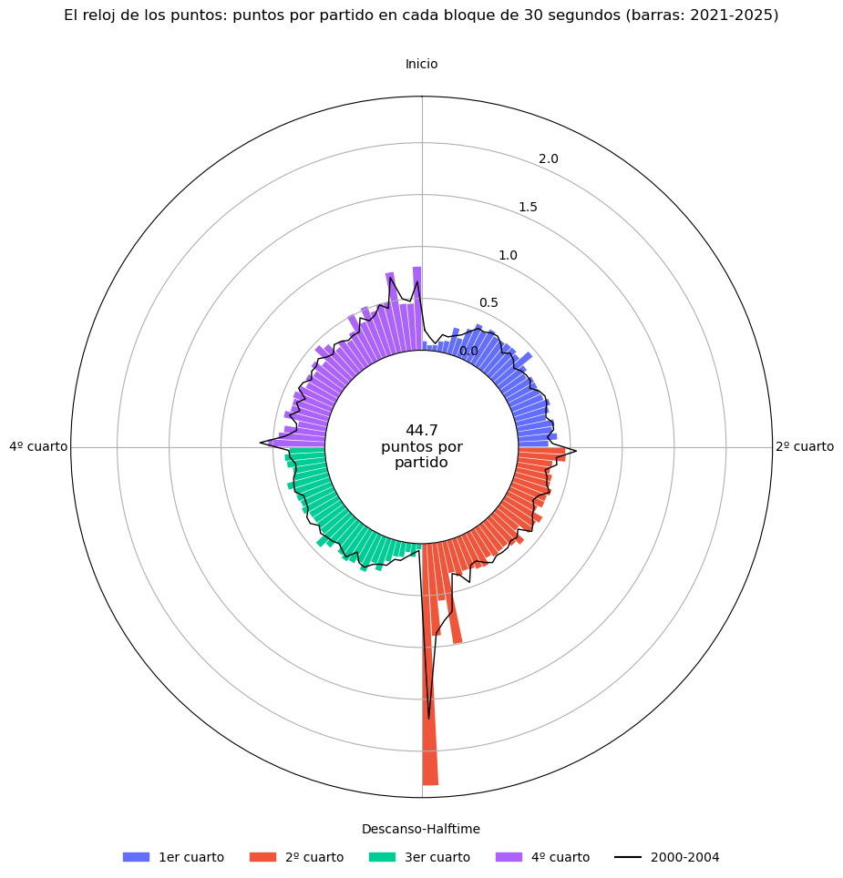

The points clock: the game as a clock face, split into 120 blocks of 30 seconds. Bars are points per game in 2021–2025, the black line is 2000–2004. The busiest half-minute of the game is the last one before half-time: 2.33 points per game today, 1.69 twenty years ago.

## What I did

The project is written as a visual report for a reader who does not know American football: a short guide to the rules and to the metric comes first, and every chart is preceded by how to read it and followed by what it shows. Each chapter starts from a question, chooses the chart type that answers it best, prints the supporting numbers in the notebook, and states the limits of what the data can show (selection effects, small samples, observational data).

## How it works

1. **Data.** Play-by-play files from nflverse (one Parquet file per season, built by nflfastR from the NFL's official game records). The first run downloads them (about 500 MB, more than 370 columns) and builds a reduced 43 MB file with only the seasons and columns used. Relocated franchises (Oakland → Las Vegas, San Diego → Los Angeles, St. Louis → Los Angeles) are unified, so their history is not split in two.
2. **The metric.** Yards are misleading: 9 yards on 3rd & 10 is a failure, and an interception is 0 yards. The analysis uses **expected points added (EPA)**, the change in expected points produced by each play, and the success rate (share of plays with positive EPA), always averaged over many plays.

   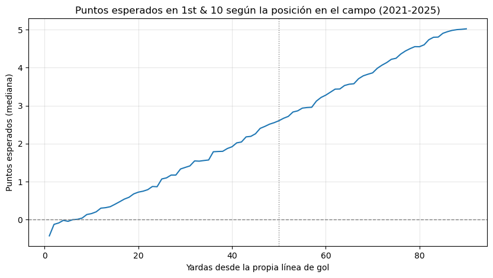

   Expected points on 1st & 10 by distance from the team's own goal line (2021–2025): about 0 on its own 5-yard line, +2.6 at midfield, +5.0 on the opponent's 10.
3. **Fair comparisons.** Most chapters compare the first and the last five seasons. Fourth-down decisions use only "normal" game situations (win probability between 10 % and 90 %, not in the last two minutes of a half), so that desperation and garbage time do not distort the decision.
4. **Six chapters, one chart type per question:** sunbursts for what is played on each down, lines and bars with 95 % confidence intervals for fourth downs, a heatmap of field position against distance, a Sankey diagram of what happens after a fourth down, logistic curves for field goals, waffle charts for kickoffs, a dumbbell plot per team for two-point tries, a funnel for drives, a polar clock for scoring, a treemap for penalties, and bar charts for the myths. The sunbursts, the Sankey, the funnel and the treemap are interactive (Plotly) and appear when the notebook is run.

## Findings

### 1 · Losing the fear of fourth down

**The change was not gradual; it was sudden, and it came late.** In 2006 the economist David Romer showed that teams were far too conservative on fourth down, but for more than a decade nothing changed. The share of fourth downs played stayed around 7 % until 2017, then rose to 17.4 % in 2025.

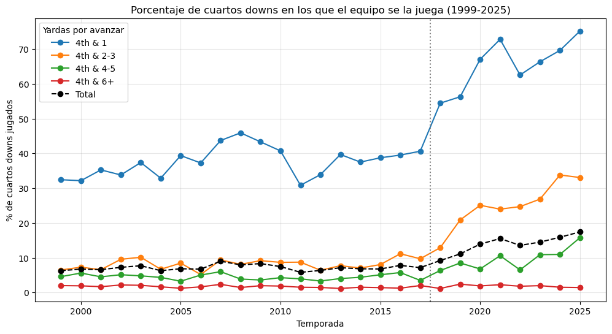

| Situation | 1999 | 2025 |
|---|---|---|
| 4th & 1 | 32.4 % | **75.2 %** |
| 4th & 2–3 | 6.5 % | **33.1 %** |
| 4th & 4–5 | 4.6 % | 15.8 % |
| 4th & 6+ | 2.0 % | 1.4 % |

The change is concentrated where going for it makes sense; with 6 or more yards to go, teams behave exactly as they did 25 years ago.

**The data already proved Romer right.** With 1999–2005 data, on 4th & 1 going for it beat the alternative in every zone of the field, and teams converted between 64 % and 85 % of the time:

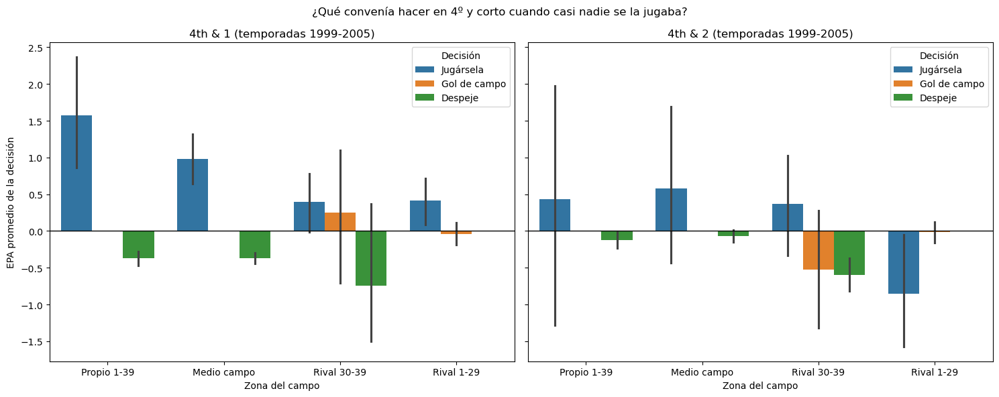

| 4th & 1 (1999–2005) | EPA going for it | EPA of the alternative | How often teams went for it |
|---|---|---|---|
| Own 1–39 | **+1.58** | −0.37 (punt) | 5.5 % |
| Midfield | **+0.98** | −0.37 (punt) | 30.2 % |
| Opponent 30–39 | +0.40 | +0.25 (field goal) | 83.9 % |
| Opponent 1–29 | +0.42 | −0.04 (field goal) | 52.8 % |

On 4th & 2 the conclusion holds with one exception: close to the end zone, the field goal was the better choice (−0.02 against −0.85). The analysis does not say "always go for it"; it says go for it where it pays.

**The league became bolder exactly where the data said it should.**

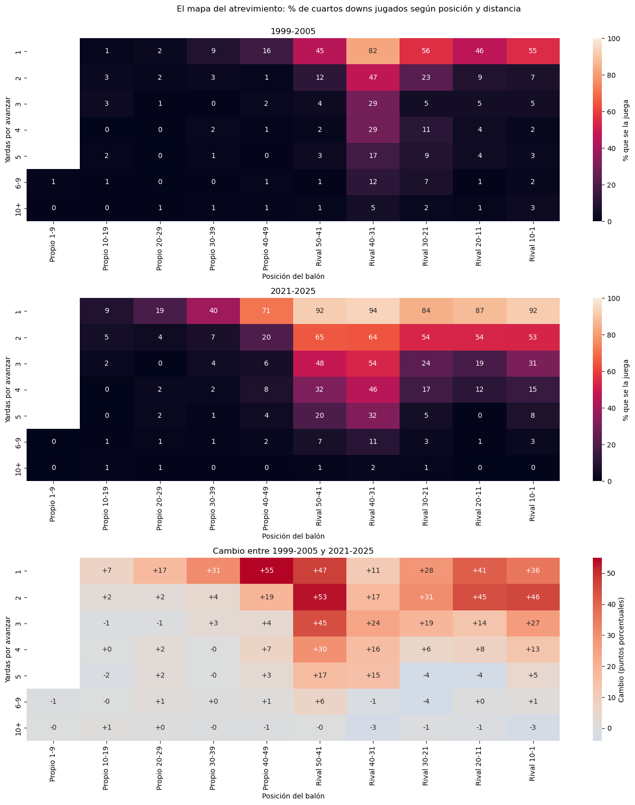

Cells with fewer than 25 plays are left blank.

At midfield on 4th & 1, teams went from going for it 3 times in 10 to 8 in 10; close to the end zone, almost no one settles for the field goal on 4th & 1. Deep in their own half, and with long distances to go, teams are still cautious.

**More risk did not mean more failure.** Comparing what happened after every fourth down in 1999–2003 and 2021–2025:

| | 1999–2003 | 2021–2025 |
|---|---|---|
| Punt | 70.1 % | 59.7 % |
| Field goal | 22.9 % | 24.9 % |
| Go for it | 6.9 % | **15.3 %** |
| → first down or touchdown | 3.9 % | **9.2 %** |
| Conversion rate when going for it | 56.2 % | 60.0 % |
| **Ball handed to the opponent (all causes)** | 77.9 % | **69.2 %** |

### 2 · Kickers reach further

**Every generation of kickers is reliable from further out.** A logistic curve per era gives the effective range:

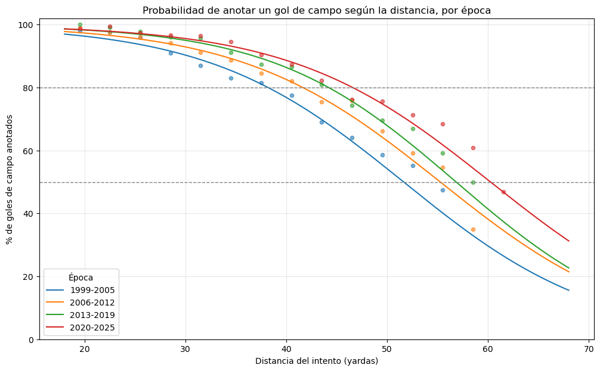

| Era | 80 % success up to | 50 % success at |
|---|---|---|
| 1999–2005 | 38.2 yards | 51.6 yards |
| 2006–2012 | 41.6 yards | 55.3 yards |
| 2013–2019 | 44.2 yards | 56.8 yards |
| 2020–2025 | **46.6 yards** | **60.2 yards** |

Kicks of 55–59 yards are made today (62 %) almost as often as 40–49-yard kicks were in 1999–2005 (68 %), and kicks of 60+ yards went from 0 of 15 to 40 % of 78.

**Domes, weather and selection do not explain it.**

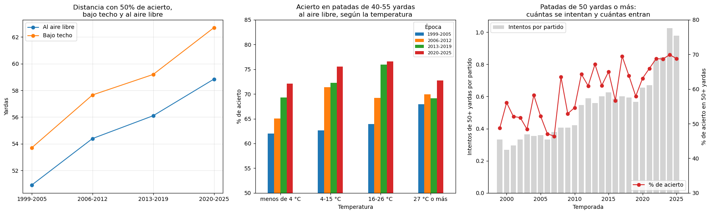

- **Domes:** more kicks are indoors now (20 % → 34 %), but the 50 % distance grew almost equally indoors (+9.0 yards) and outdoors (+7.9).
- **Weather:** below 4 °C, success from 40–55 yards outdoors rose from 62.0 % to 72.1 %; today's kickers in the cold beat the kickers of 25 years ago on a mild day.
- **Selection:** if only easy kicks were attempted, there would be fewer long ones. Instead, attempts of 50+ yards per game tripled (about 0.33 → 1), and their success rate still rose (49 % → 69 %). From 30–39 yards, where teams attempt almost every possible kick, success rose from 82.8 % to 93.3 %.

The most likely explanation is the direct one: kickers are better.

### 3 · The league rewrites the rules

**Every kickoff rule left a step in the data.** Kickoffs concentrated the most concussions, so for a decade the league tried to remove returns, and from 2024 it tried to bring them back safely:

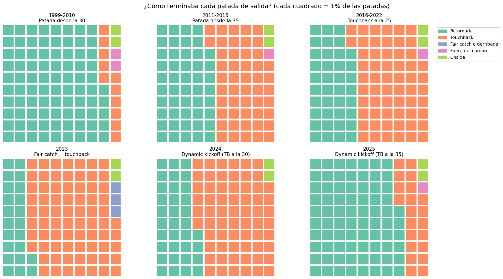

| Rule period | Returned | Touchback |
|---|---|---|
| 1999–2010 · kickoff from the 30 | 84.7 % | 11.2 % |
| 2011–2015 · kickoff from the 35 | 48.4 % | 48.5 % |
| 2016–2022 · touchback to the 25 | 37.9 % | 59.2 % |
| 2023 · fair catch counts as touchback | **21.7 %** | 73.0 % |
| 2024 · dynamic kickoff, touchback to the 30 | 33.5 % | 64.2 % |
| 2025 · dynamic kickoff, touchback to the 35 | **76.2 %** | 20.7 % |

The 2024 dynamic kickoff alone did not bring returns back, because a touchback to the 30 was still a good deal for the kicking team. Moving it to the 35 made it the worst option, and returns jumped.

**The 2011 rule had a side effect: drives started further back.**

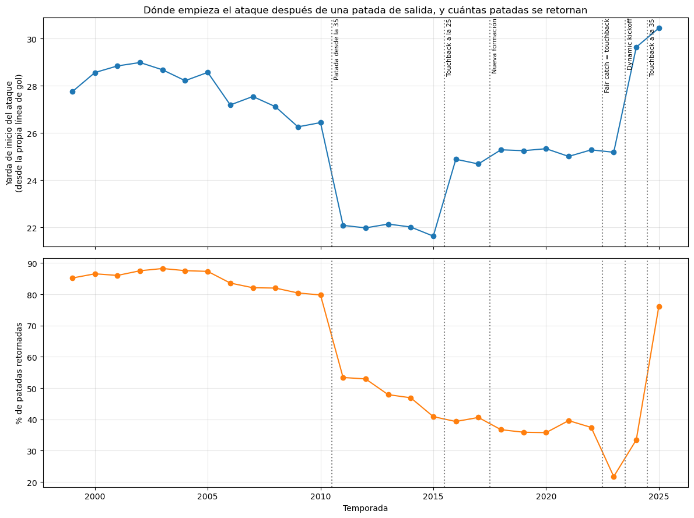

Swapping returns for touchbacks at the 20 moved the average start of the drive from about the 26–29-yard line to the 22. The 2016 touchback at the 25 compensated, and the dynamic kickoff took it to the best level of the series (29.6 in 2024, 30.5 in 2025), about half an expected point more per drive than in 2011–2015.

**The extra point stopped being free.** In 2015 it was moved back from the 2 to the 15 (a kick of about 33 yards), because it was made more than 99 % of the time.

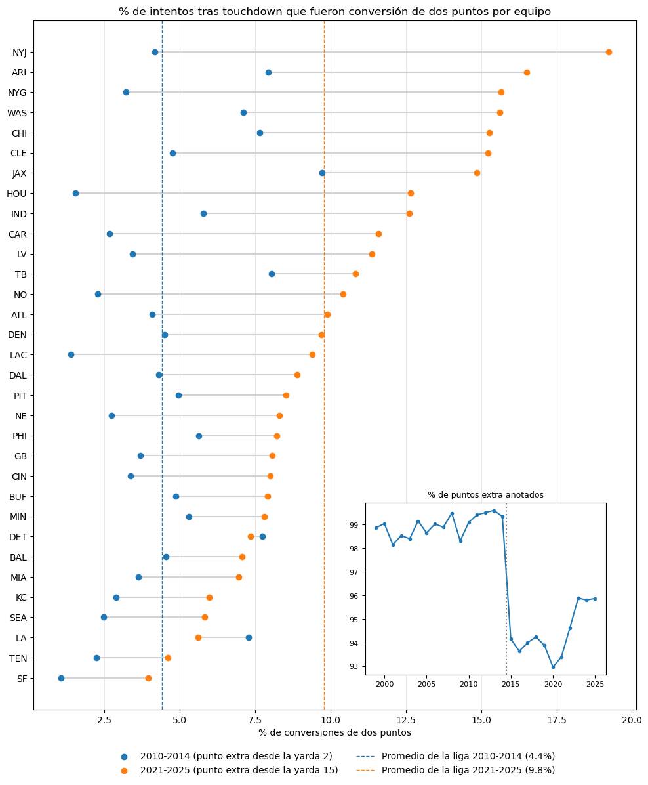

- Extra-point success fell from 99.3 % in 2014 to 94.2 % in 2015: from one miss in 140 to one in 17.
- Two-point tries rose from 4.4 % of attempts (2010–2014) to 9.8 % (2021–2025), in 30 of the 32 teams.
- The rule created an almost perfect tie: since 2015 an extra point is worth 0.944 expected points and a two-point try 0.952. Yet teams still kick 9 times out of 10, the same preference for the option that rarely fails visibly that Romer found on fourth down.

### 4 · How teams score

**Offences convert more drives into points, starting from further back.**

| Stage of the drive | 1999–2003 | 2021–2025 |
|---|---|---|
| Cross midfield | 55.5 % | 57.9 % |
| Reach the red zone | 31.0 % | 35.4 % |
| End in a touchdown | 17.6 % | **22.0 %** |
| End in a field goal | 12.3 % | 15.5 % |
| **End in points** | 29.9 % | **37.5 %** |
| Average starting yard line | 31.7 | 29.4 |

Two parts of the gain connect with earlier chapters: touchdowns from drives with a fourth down converted in the red zone doubled (3.5 % → 7.1 %, about a fifth of the increase), and field goals from drives that never reached the red zone rose from 31.2 % to 41.0 %.

**The last half-minute before half-time is the busiest of the game** (points clock at the top). In the last two minutes of the second quarter, compared with the rest of the game (2021–2025): 2.39 points per minute against 0.66, 4.5 plays per minute against 2.0, 80 % passes against 58 %, and a positive EPA per play (+0.065 against −0.015). Losing the ball costs little with seconds left, defences give up short yards, and 35 % of the points come from field goals, which better kickers make more reachable. At the end of the game, the leading team only wants to run the clock, so the peak is much smaller.

### 5 · Myths, tested against the data

**"Home advantage is worth a lot."** Real, but smaller than believed, and shrinking.

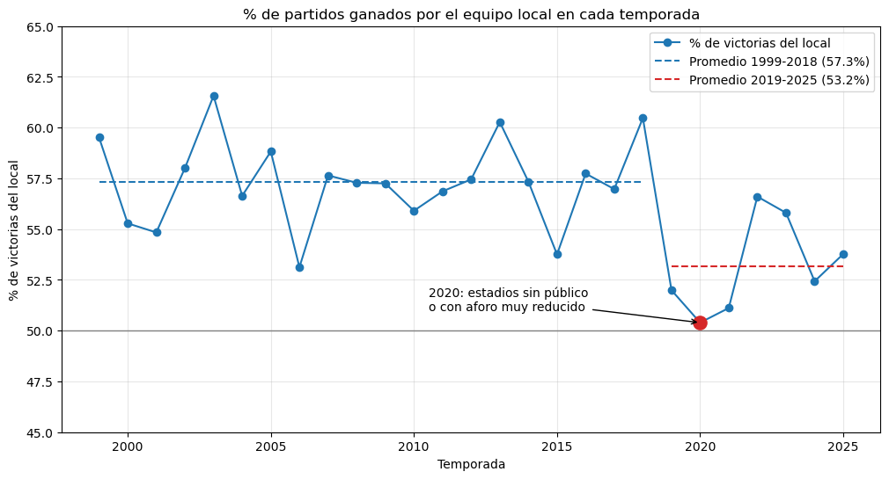

The home team won 57.3 % of games in 1999–2018 and 53.2 % since 2019. The empty stadiums of 2020 were the minimum (50.4 %), but 2019, with full stadiums, was already at 52.0 %, so the crowd cannot be the whole story.

**"Icing the kicker works."** A little, and only from mid range.

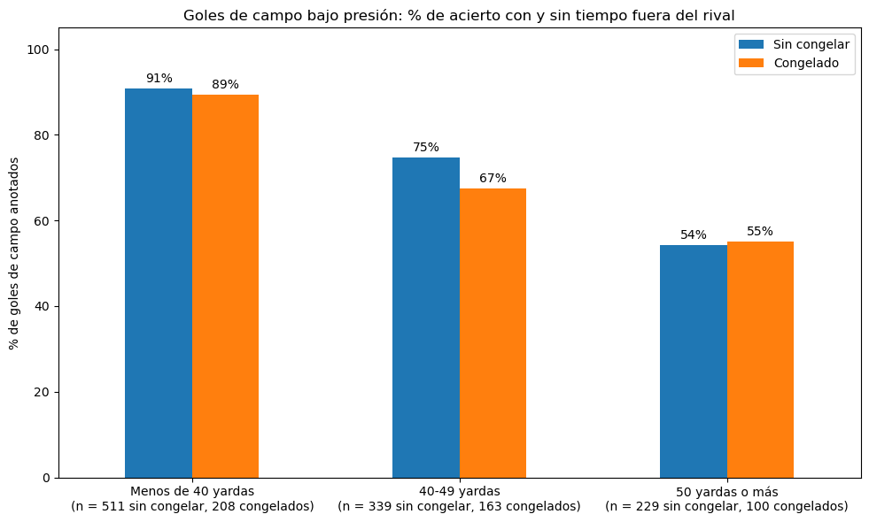

Of 1,550 pressure kicks (last 3 minutes or overtime, kicking team tied or down by 3 or less), 471 were iced. From 40–49 yards, iced kickers made 67.5 % against 74.6 %; under 40 and over 50 yards there is no difference. With 100–200 iced kicks per bin, the result is suggestive, not conclusive.

**"That quarterback is bad."** Or is his line not protecting him?

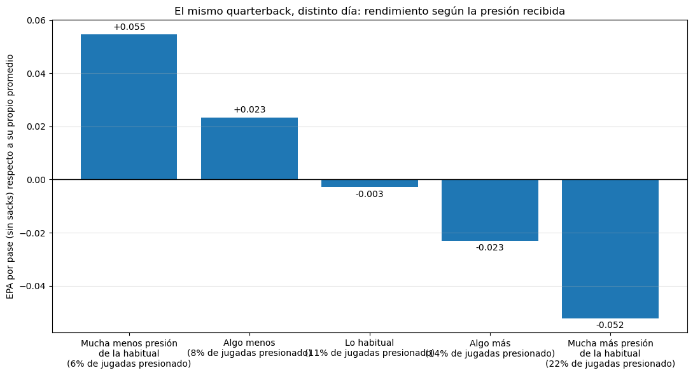

Comparing each quarterback with himself across 14,144 games, and excluding sacks from his performance so the relationship is not built in, the effect is a clean staircase: on his lowest-pressure days he plays +0.055 EPA per dropback above his own average, on his highest-pressure days −0.052. Over about 35 passes, that is almost 4 expected points a game.

**Penalties.** The total barely moved (12.6 → 12.0 per game), but roughing the passer (+14 %) and defensive holding (+22 %) are called more, and penalties typical of modern offences rose sharply: ineligible man downfield (+255 %) and illegal formation (+188 %).

## Conclusions

- **Data changes decisions slowly, then quickly.** The evidence on fourth down existed from the start of the century; the league took more than a decade to act, and when it did, it changed where the numbers said it should.
- **Players changed too.** Kickers reach 8–9 yards further, and the usual external explanations are ruled out with the data itself.
- **Teams respond to incentives.** Every rule change produced an immediate, visible step; when the league made an option more valuable, teams chose it more.
- **Offences are more efficient**, and part of the gain traces back to the earlier chapters.
- **Some beliefs survive the data, some only partly.** Home advantage is smaller than believed, icing works only a little, and a quarterback cannot be judged without his pressure.
- **Limits.** The data are observational, several comparisons are affected by selection (teams choose when to go for it or ice a kicker), EPA comes from a model, and some samples are small. The notebook flags each case, as well as the data-quality issues found along the way (an unreliable clock in 1999, duplicated plays in one 2011 game, penalties that changed name).

## Repository

| File | Content |
|---|---|
| [`nfl_1999_2025_visualisation.ipynb`](nfl_1999_2025_visualisation.ipynb) | The full report as a notebook: rules guide, six chapters, conclusions, limitations and references |
| [`report_es.pdf`](report_es.pdf) | The same report as a 76-page PDF |
| [`requirements.txt`](requirements.txt) | Exact library versions |

The notebook and the charts are in Spanish, as submitted. To run it: `pip install -r requirements.txt`, then run the notebook from top to bottom. The first run downloads the nflverse play-by-play files and builds the reduced Parquet file in `data/`.

**Data:** [nflverse](https://github.com/nflverse/nflverse-data/releases/tag/pbp) play-by-play (nflfastR), seasons 1999–2025. **Stack:** Python, pandas, matplotlib, seaborn, Plotly, pywaffle, SciPy, PyArrow.
